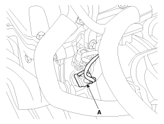

# Kia Sportage: Sensor de Temperatura do Óleo CVVT (OTS): Procedimentos de Reparo

[Home](../../index.md) / [Manual de Serviço e Reparo do Kia Sportage SL](../sportage-482.md) / [Controle do Motor / Sistema de Combustível](sportage-582.md) / [Sistema de Controle do Motor](sportage-587.md) / Sensor de Temperatura do Óleo CVVT (OTS): Procedimentos de Reparo

## Inspeção

1. Desligue o interruptor de ignição.

2. Desconecte o conectador do OTS.

3. Remova o OTS.

4. Imerso o termistor do sensor no líquido de refrigeração do motor, mede a resistência entre os terminais 1 e 2 do OTS.

5. Verifique que a resistência esteja dentro da especificação.

   ```
   Especificação: Consulte “Especificação”
   ```

## Remoção

1. Desligue o interruptor de ignição.

2. Desconecte o conectador do OTS (A).

3. Remova o OTS.

   

## Instalação

1. A instalação é o inverso da remoção.
