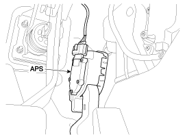

# Kia Sportage: Sensor de Posição do Acelerador (SPA): Descrição e Operação

[Home](../../index.md) / [Manual de Serviço e Reparo do Kia Sportage SL](../sportage-482.md) / [Controle do Motor / Sistema de Combustível](sportage-582.md) / [Sistema de Controle do Motor](sportage-587.md) / Sensor de Posição do Acelerador (SPA): Descrição e Operação

## Descrição

O Sensor de Posição do Acelerador (SPA) é instalado no módulo do acelerador e detecta o ângulo de rotação do acelerador. O SPA é um dos sensores mais importantes no sistema de controle do motor, então consiste em dois sensores que adaptam a linha de energia e a linha de terra individualmente. O segundo sensor monitora o primeiro e sua tensão de saída é metade da do primeiro. Se a razão entre os sensores 1 e 2 estiver fora do intervalo (aproximadamente 1/2), o sistema de diagnóstico julga que é anormal.

