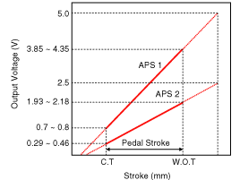

# Kia Sportage: Sensor da Posição do Acelerador (SPA): Especificações

[Home](../../index.md) / [Manual de Serviço e Reparo do Kia Sportage SL](../sportage-482.md) / [Controle do Motor / Sistema de Combustível](sportage-582.md) / [Sistema de Controle do Motor](sportage-587.md) / Sensor da Posição do Acelerador (SPA): Especificações

## Especificação

| Posição do Acelerador | Tensão de Saída (V) |  |
| --- | --- | --- |
| SPA1 | SPA2 |  |
| C.T | 0,7 ~ 0,8 | 0,29 ~ 0,46 |
| A.T.O | 3,85 ~ 4,35 | 1,93 ~ 2,18 |

