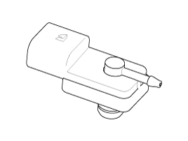

# Kia Sportage: Sensor de Pressão do Tanque de Combustível (FTPS): Descrição e Operação

[Home](../../index.md) / [Manual de Serviço e Reparo do Kia Sportage SL](../sportage-482.md) / [Controle do Motor / Sistema de Combustível](sportage-582.md) / [Sistema de Controle do Motor](sportage-587.md) / Sensor de Pressão do Tanque de Combustível (FTPS): Descrição e Operação

## Descrição

Sensor de Pressão do Tanque de Combustível (FTPS) é um componente do sistema de controle de emissões evaporativas. Está instalado no tanque de combustível próximo à montagem do bomba de combustível. Verifica o sistema evaporativo e detecta uma fuga evaporativa no sistema.

