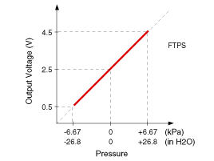

# Kia Sportage: Sensor de Pressão do Tanque de Combustível (FTPS): Especificações

[Home](../../index.md) / [Manual de Serviço e Reparo do Kia Sportage SL](../sportage-482.md) / [Controle do Motor / Sistema de Combustível](sportage-582.md) / [Sistema de Controle do Motor](sportage-587.md) / Sensor de Pressão do Tanque de Combustível (FTPS): Especificações

## Especificação

| Pressão [kPa (kgf/cm?, in H2O)] | Voltagem de Saída (V) |
| --- | --- |
| -6,67 (-0,068, -26,8) | 0,5 |
| 0 | 2,5 |
| +6,67 (0,068, 26,8) | 4,5 |

