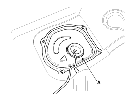
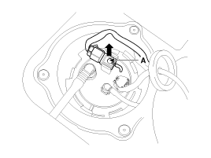

# Kia Sportage: Sensor de Pressão do Tanque de Combustível (FTPS): Procedimentos de Reparo

[Home](../../index.md) / [Manual de Serviço e Reparo do Kia Sportage SL](../sportage-482.md) / [Controle do Motor / Sistema de Combustível](sportage-582.md) / [Sistema de Controle do Motor](sportage-587.md) / Sensor de Pressão do Tanque de Combustível (FTPS): Procedimentos de Reparo

## Inspeção

1. Conecte o GDS na Conectora de Linha de Dados (DLC).

2. Medida da tensão de saída do FTPS.

   ```
   Especificação: Consulte "Especificação"
   ```

## Remoção

1. Desligue a chave do ignição e desconecte o cabo negativo (-) da bateria.

2. Remova o banco traseiro (Consulte "Banco" no grupo BD).

3. Remova a tampa de serviço do bomba de combustível (A).

   

4. Desconecte o conector do sensor de pressão do tanque de combustível (A).

5. Remova o sensor de pressão do tanque de combustível após soltar as garras verticalmente.

   

## Instalação

> **Cuidado**
>
> - Instale o componente com as torques especificadas.
> - Tenha em mente que danos internos podem ocorrer se o componente cair. Se o componente cair, inspecione antes de instalar.

> **Cuidado**
>
> - Insira o sensor na abertura de instalação e tenha cuidado para não danificar.

1. A instalação é o contrário da remoção.
