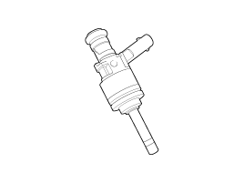

# Kia Sportage: Injetor: Descrição e Operação

[Home](../../index.md) / [Manual de Serviço e Reparo do Kia Sportage SL](../sportage-482.md) / [Controle do Motor / Sistema de Combustível](sportage-582.md) / [Sistema de Controle do Motor](sportage-587.md) / Injetor: Descrição e Operação

## Descrição

Com base nas informações de vários sensores, o ECM pode calcular a quantidade de combustível a ser injetada. O injetor de combustível é um valveo operado por solenoide e a quantidade de injeção de combustível é controlada pelo tempo de injeção. O ECM controla cada injetor ao chamar a circutio de controle. Quando o ECM energiza o injetor ao chamar a circutio de controle, a tensão da circutio deve ser baixa (teoricamente 0V) e o combustível é injetado. Quando o ECM desenergiza o injetor ao abrir o circutio de controle, o injetor de combustível é fechado e a tensão do circutio deve picar momentaneamente, e depois se estabilizar na tensão do sistema.

