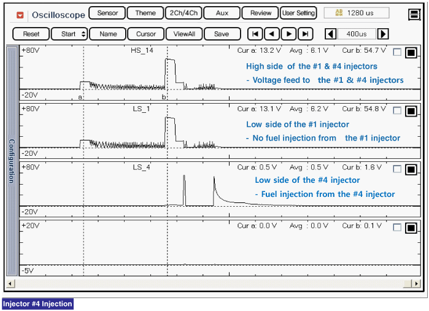

# Kia Sportage: Injetor: Diagnóstico

[Home](../../index.md) / [Manuais de Serviço e Reparo do Kia Sportage SL](../sportage-482.md) / [Controle do Motor / Sistema de Combustível](sportage-582.md) / [Sistema de Controle do Motor](sportage-587.md) / Injetor: Diagnóstico

## Forma de Onda do Sinal

As três formas de onda abaixo foram extraídas dos injetores #1 e #4. A forma de onda superior é do lado alto (lado de alimentação) dos injetores #1 e #4, enquanto a forma de onda do meio é do lado baixo (lado de terra) do injetor #1 e a forma de onda inferior é do lado baixo do injetor #4.

A forma de onda do meio é a mesma que a forma de onda superior porque não há terra para o circuito. Sem corrente elétrica fluindo pelo circuito, o injetor #1 não é energizado e o combustível não flui.

A forma de onda inferior mostra que a terra é fornecida e há uma queda de tensão no injetor #4. Com corrente elétrica fluindo pelo circuito, o injetor #4 é energizado e o combustível flui.

