# Kia Sportage:Injector: Procedimentos de Reparo

[Home](../../index.md) / [Manual de Serviço e Reparo do Kia Sportage SL](../sportage-482.md) / [Controle do Motor / Sistema de Combustível](sportage-582.md) / [Sistema de Controle do Motor](sportage-587.md) / Procedimentos de Reparo do Injector

## Inspeção

1. Desligue o interruptor de ignição.

2. Desconecte o conector do injetor.

3. Mede a resistência entre os terminais 1 e 2 do injetor.

4. Verifique se a resistência está dentro da especificação.

   ```
   Especificação: Consulte a "Especificação"
   ```

## Remoção

> **Aviso**
>
> - Em caso de remoção do bomba de combustível de alta pressão, tubo de combustível de alta pressão, tubo de entrega e injetor, há o risco de lesão causada pela vazamento de combustível de alta pressão. Portanto, não realize nenhuma reparação imediatamente após o motor parar.

1. Desligue o interruptor de ignição e desconecte o cabo negativo (-) da bateria.

2. Libere a pressão residual no tubo de combustível (Consulte o Sistema de Entrega de Combustível - Procedimentos de Reparo - "Liberação da Pressão Residual no Tubo de Combustível").

   > **Cautela**
   >
   > - Ao remover o relé do bomba de combustível, um Código de Falha Diagnóstico (DFC) pode ocorrer. Exclua o código com o GDS após a conclusão do trabalho de "Liberação da Pressão Residual no Tubo de Combustível".

3. Remova a montagem do tubo de entrega e injetor (Consulte "Tubo de Entrega" neste grupo).

4. Remova a pinça de retenção (A), e, em seguida, separe o injetor do tubo de entrega.

   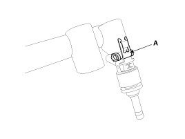

## Instalação

> **Cuidado**
>
> - Não reutilize a viga de retenção do injetor, o anel O, o anel de respaldo, o selo de vedação ou o anel de vedação do combustível. Uma vez removido o injetor, os cinco componentes devem ser substituídos por novos.

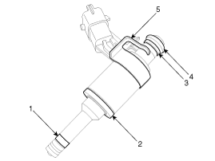

| 1) | Anel de vedação do combustível |
| --- | --- |

| 2) | Anel de vedação |
| --- | --- |

| 3) | Anel de respaldo |
| --- | --- |

| 4) | Anel O |
| --- | --- |

| 5) | Viga de retenção |
| --- | --- |

> **Nota**
>
> - Os itens 1, 3 e 4 são fornecidos em um único kit.

> **Cuidado**
>
> - Instale o componente com as torques especificadas.
> - Tenha em mente que danos internos podem ocorrer quando o componente é solto. Se o componente foi solto, inspecione antes de instalar.

> **Cuidado**
>
> - Aplicar óleo de motor no anel O do injetor.

> **Cuidado**
>
> - Não reutilize as varetas de fixação do tubo de entrega. Uma vez removido o tubo de entrega, as varetas devem ser substituídas por novas.

> **Cuidado**
>
> - Ao inserir o injetor, tenha cuidado para não danificar a ponta do injetor.

> **Cuidado**
>
> - Ao substituir o anel de vedação, a placa de aço (A) deve estar voltada para a parte de instalação do cilindro e a placa de borracha (B) deve estar voltada para a parte do corpo do injetor.

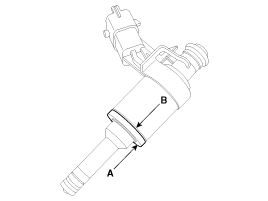

> **Cuidado**
>
> - Não reutilize o anel de vedação do combustível.
> - Tenha cuidado para não aplicar óleo de motor no anel de vedação do combustível.

> **Cuidado**
>
> - Evite soltar a mangueira de combustível (incluindo injetores) ou bater nela em objetos duros, pois danos aos componentes internos podem ocorrer. Se necessário, inspecione visualmente e confirme a operação correta com testes de desempenho antes de reutilizar.
> - Antes de instalar o injetor na cabeça do cilindro, limpe a abertura do injetor e evite contaminantes de entrar na abertura do injetor. Ao instalar o injetor, evite bater a ponta do injetor em qualquer um dos componentes adjacentes, pois a ponta pode se danificar pelo impacto.
> - Ao apertar as três varetas de fixação do tubo de entrega de combustível, aperte manualmente primeiro, e depois aperte na sequência correta ( > > ) em várias ciclos até a torque especificado. O tubo de entrega deve se mover menos de 1/8 polegada (aproximadamente 3mm), sempre que cada vareta for apertada.

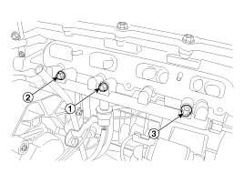

1. A instalação é o inverso da remoção.

## Troca

O selo de injeção de combustível deve ser substituído por um novo para prevenir vazamentos após a remoção da injeção.

1. Remova o selo de combustão (A) com uma tesoura.

   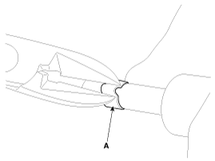

   > **Cuidado**
   >
   > - Agarre cuidadosamente o anel de vedação, puxe-o para formar um pequeno laço e então corte-o.
   > - Cuide para não danificar a superfície do suporte do valve com a tesoura.

2. Antes de montar o anel de vedação, limpe a vagem com uma gaze limpa.

   Qualquer coking na superfície de vedação da injeção deve ser cuidadosamente removido com uma escova de fio de latão.

   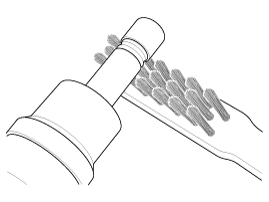

   > **Cuidado**
   >
   > - As superfícies do novo anel de vedação devem estar limpas e livres de óleo.

3. Coloque o selo de combustão no cone e puxe o selo para baixo conforme indicado na foto.

   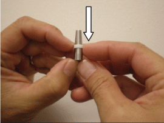

   > **Nota**

   Seus dedos funcionarão melhor para a instalação do Selo de Combustão sobre o cone.

4. Puxe o selo para baixo até que ele esteja próximo ao fundo do cone, conforme mostrado na foto.

   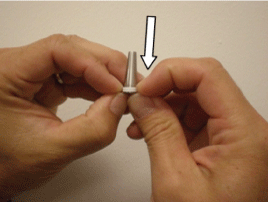

5. Coloque o cone (com selo) no final da injeção.

   Coloque a ferramenta de dimensionamento (SST Número: 09353-2B000) sobre o cone. Certifique-se de que a flange da ferramenta esteja voltada para o selo, conforme mostrado.

   Comprenda a ferramenta para trabalhar o selo sobre a injeção e na vagem.

   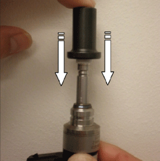

6. Porque o selo se estenderá enquanto passa pelo final da injeção, estará um pouco maior após a instalação.

   Deixe a injeção e o selo se estabelecerem por alguns minutos, o selo pode diminuir de tamanho.

   Inspeção o selo para danos antes de continuar.

   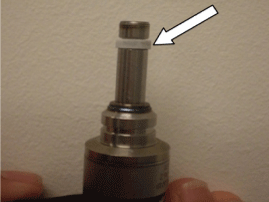

7. Coloque a ferramenta de dimensionamento (flange para cima) sobre o selo. Vire a ferramenta ligeiramente enquanto empurra-a para baixo sobre o selo. Isso deve reduzir o tamanho do selo.

   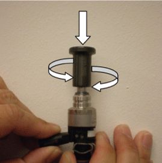

   > **Cuidado**
   >
   > - Cuide para não aplicar óleo do motor no anel de vedação de combustão.

8. Coloque a injeção no cabeçote conforme indicado.

   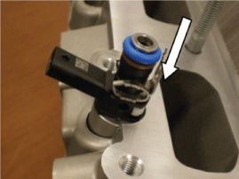

9. Vire ligeiramente enquanto pressiona a injeção no lugar no cabeçote.

   Isso deve completar a dimensionamento do selo.

   Remova a injeção e inspecione o selo antes de concluir o processo de instalação da injeção.

   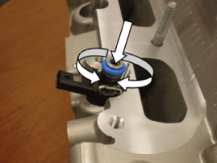

10. Se a injeção vier com um amortecedor de aço protetor mantido em seu lugar por um ganchinho de mola; ambos terão que ser removidos antes da instalação.

   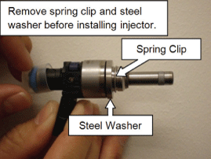

11. Instale o Amortecedor de selo sobre a injeção com o lado de borracha (degrau) voltado para a injeção.

   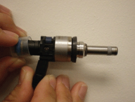

12. O lado de borracha degraiado do selo vai para a injeção.

   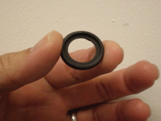

13. O lado plano do amortecedor vai para o cabeçote.

   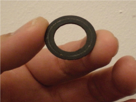
