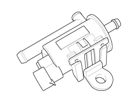

# Kia Sportage: Valvula de Solenoide de Controle de Purga (VSCP): Descrição e Operação

[Home](../../index.md) / [Manual de Serviço e Reparo do Kia Sportage SL](../sportage-482.md) / [Controle do Motor e Sistema de Combustível](sportage-582.md) / [Sistema de Controle do Motor](sportage-587.md) / Valvula de Solenoide de Controle de Purga (VSCP): Descrição e Operação

## Descrição

A Valvula de Solenoide de Controle de Purga (VSCP) é instalada no tanque de surto e controla a passagem entre o canister e o manifold de admissão. É uma valvula solenoide e está aberta quando o ECM (Unidade de Controle do Motor) chama a linha de controle da valvula. Quando a passagem está aberta (VSCP ON), o vapor de combustível armazenado no canister é transferido para o manifold de admissão.

