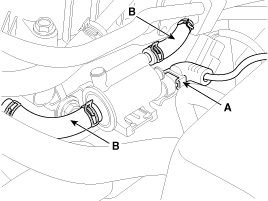
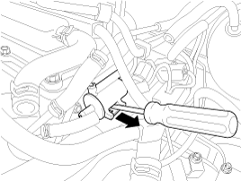
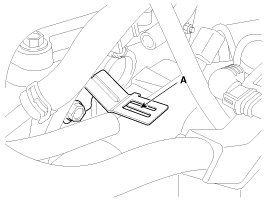

# Kia Sportage: Valvula de Solenoide de Purga (VSP): Procedimentos de Reparo

[Home](../../index.md) / [Manual de Serviço e Reparo do Kia Sportage SL](../sportage-482.md) / [Controle do Motor / Sistema de Combustível](sportage-582.md) / [Sistema de Controle do Motor](sportage-587.md) / Valvula de Solenoide de Purga (VSP): Procedimentos de Reparo

## Inspeção

1. Desligue o interruptor de ignição.

2. Desconecte o conector da VSP.

3. Mede a resistência entre os terminais 1 e 2 da VSP.

4. Verifique se a resistência está dentro da especificação.

   ```
   Especificação: Consulte “Especificação”
   ```

## Remoção

1. Desligue o interruptor de ignição e desconecte o cabo negativo (-) da bateria.

2. Desconecte o conector da valvula de solenoide de purga (A).

3. Desconecte as mangueiras de vapor (B) da valvula de solenoide de purga.

   

4. Remova a valvula na direção do seta do gancho.

   

## Instalação

> **Cuidado**
>
> - Instale o componente com as torques especificadas.
> - Tenha cuidado para não causar danos internos ao soltar o componente. Se o componente foi solto, inspecione antes de instalar.

> **Cuidado**
>
> - Tenha cuidado para manter material estranho fora da valvula.

> **Cuidado**
>
> - Instale a valvula de solenoide de purga após levantar o gancho (A) do gancho.



1. A instalação é o inverso da remoção.

   ```
   Gancho do gancho da valvula de solenoide de purga: 9.8 ~ 11.8 N.m (1.0 ~ 1.2 kgf.m, 7.2 ~ 8.7 lb-ft)
   ```
