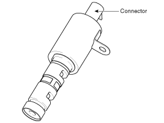

# Kia Sportage: CVVT Oil Control Valve (OCV): Descrição e Operação

[Início](../../index.md) / [Manual de Serviço e Reparo do Kia Sportage SL](../sportage-482.md) / [Controle do Motor e Sistema de Combustível](sportage-582.md) / [Sistema de Controle do Motor](sportage-587.md) / CVVT Oil Control Valve (OCV): Descrição e Operação

## Descrição

O sistema de Variação Contínua da Tempo de Abertura das Valvas (CVVT) avança ou atrasa o tempo de abertura das valvas de admissão e exaustão de acordo com o sinal de controle do ECM, que é calculado com base na velocidade do motor e no carregamento.

Controlando o CVVT, ocorre o sobreposição ou subposição das valvas, o que melhora a economia de combustível e reduz as emissões de gases de escape (NOx, HC) e melhora o desempenho do motor através da redução da perda de bombagem, do efeito de EGR interno, da estabilidade da combustão, da eficiência volumétrica e do trabalho de expansão.

Este sistema consiste em

- o CVVT Oil Control Valve (OCV), que fornece o óleo do motor ao cam phaser ou corta o óleo do motor do cam phaser de acordo com o sinal de controle PWM (Pulse With Modulation) do ECM,

- o CVVT Oil Temperature Sensor (OTS), que mede a temperatura do óleo do motor,

- e o Cam Phaser, que varia o faseamento do cam por meio da força hidráulica do óleo do motor.

O óleo do motor que sai do CVVT oil control valve varia o faseamento do cam, no sentido (Avanço de Admissão/Atraso de Exaustão) ou no sentido oposto (Atraso de Admissão/Avanço de Exaustão) da rotação do motor, rotacionando o rotor conectado ao eixo do cam na câmara do cam phaser.

