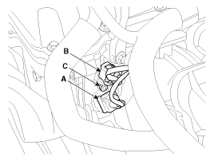
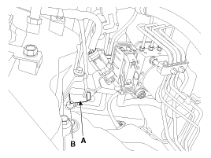

# Kia Sportage: CVVT Oil Control Valve (OCV): Procedimentos de Reparo

[Home](../../index.md) / [Manual de Serviço e Reparo do Kia Sportage SL](../sportage-482.md) / [Controle de Execução do Motor / Sistema de Combustível](sportage-582.md) / [Sistema de Controle do Motor](sportage-587.md) / Procedimentos de Reparo do CVVT Oil Control Valve (OCV)

## Inspeção

1. Desligue o interruptor de ignição.

2. Desconecte o conector do OCV.

3. Mede a resistência entre os terminais 1 e 2 do OCV.

4. Verifique se a resistência está dentro da especificação.

   ```
   Especificação: Consulte “Especificação”
   ```

## Remoção

[Bank 1 / Intalação de Admissão]

1. Desligue o interruptor de ignição e desconecte o cabo negativo (-) da bateria.

2. Remova o OTS (A).

3. Desconecte o conector do CVVT oil control valve (B).

4. Remova a válvula do motor, deslocando a viga de instalação (C).

   

[Bank 1 / Exaustão]

1. Desligue o interruptor de ignição e desconecte o cabo negativo (-) da bateria.

2. Desconecte o conector do CVVT oil control valve (A).

3. Remova a viga de instalação (B), e então remova a válvula do motor.

   

## Instalação

> **Cuidado**
>
> - Instale o componente com as torques especificadas.
> - Tenha em mente que danos internos podem ocorrer se o componente cair. Se o componente cair, inspecione antes de instalar.

> **Cuidado**
>
> - Aplicar óleo de motor na o-ring da válvula.

1. A instalação é o inverso da remoção.

   ```
   Torque do parafuso de instalação do CVVT oil control valve:
   9.8 ~ 11.8 N.m (1.0 ~ 1.2 kgf.m, 7.2 ~ 8.7 lb-ft)
   ```
