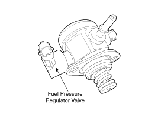

# Kia Sportage: Valvula de Controle da Pressão do Combustível: Descrição e Operação

[Home](../../index.md) / [Manual de Serviço e Reparo do Kia Sportage SL](../sportage-482.md) / [Controle do Motor / Sistema de Combustível](sportage-582.md) / [Sistema de Controle do Motor](sportage-587.md) / Valvula de Controle da Pressão do Combustível: Descrição e Operação

## Descrição

A Valvula de Regulação da Pressão do Combustível está instalada no bomba de alta pressão de combustível e controla o fluxo de combustível que flui para os injetores de acordo com o sinal calculado pelo ECM com base em diversas condições do motor.

