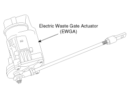

# Kia Sportage: Atuador de Porta de Resíduos Elétrica (EWGA): Descrição e Operação

[Home](../../index.md) / [Manual de Serviço e Reparo do Kia Sportage SL](../sportage-482.md) / [Controle do Motor / Sistema de Combustível](sportage-582.md) / [Sistema de Controle do Motor](sportage-587.md) / Atuador de Porta de Resíduos Elétrica (EWGA): Descrição e Operação

## Descrição

O Atuador de Controle Elétrico da Porta de Resíduos (EWGA) está instalado no turbocharger.

Ele opera o vano na Porta de Resíduos Turbocharger (WGT) e regula a quantidade de ar comprimido pelo sinal PWM do ECM. Este atuador consiste em um motor DC que opera o vano, um engradeiro de 2 etapas que aumenta o torque do motor DC, um sensor de posição que detecta o status do vano, e um módulo de controle elétrico que drive o motor DC.

