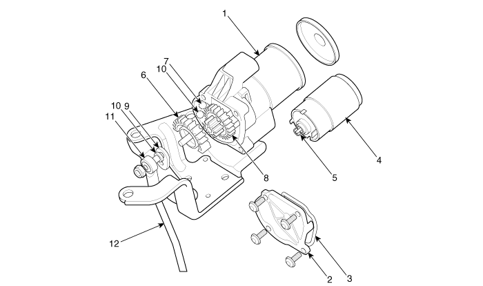

# Atuador de Válvula de Descarga Elétrica (AVEDE) — Componentes e localização

[Home](../../index.md) / [Manual de Serviço e Reparo](../sportage-482.md) / [Controle do Motor / Sistema de Combustível](sportage-582.md) / [Sistema de Controle do Motor](sportage-587.md) / Componentes e localização

## Diagrama

## Legenda

| Nº | Componente |
| --- | --- |
| 1 | Caixa |
| 2 | Cobertura |
| 3 | Cobertura de Selagem |
| 4 | Motor |
| 5 | Pinhão |
| 6 | Eixo com Engrenagem |
| 7 | Montagem PCB |
| 8 | Engrenagem Média |
| 9 | Leva |
| 10 | Pin de Leva |
| 11 | Extremidade do Cinto |
| 12 | Cinto |
