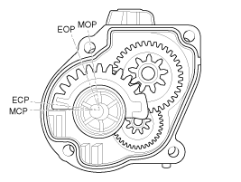
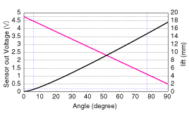

# Kia Sportage: Atuador de Porta de Resíduos Elétrica (EWGA): Especificações

[Home](../../index.md) / [Manuais de Serviço e Reparo do Kia Sportage SL](../sportage-482.md) / [Controle do Motor / Sistema de Combustível](sportage-582.md) / [Sistema de Controle do Motor](sportage-587.md) / Atuador de Porta de Resíduos Elétrica (EWGA): Especificações

## Especificações

[Sensor de Posição do EWGA]

| Posição | Tensão de Saída [V] | Ângulo de Operação [°] | Comprimento do Mastro [mm], referência |
| --- | --- | --- | --- |
| Posição de Parada Mecânica do Fim (MCP) | 4,8 | 0 | 0 |
| Posição de Parada Elétrica do Fim (ECP) | 4,2 | 12 | 1,8 |
| Posição de Parada Elétrica do Aberto (EOP) | 1 | 79 | 16 |
| Posição de Parada Mecânica do Aberto (MOP) | 0,5 | 90 | 18 |

[Motor DC do EWGA]

| Item | Especificação |
| --- | --- |
| Resistência do Enroscado (?) | 1,48 ~ 1,96 [21°C(69,8°F)] |
