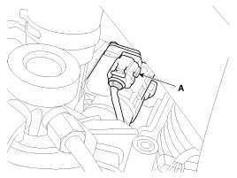
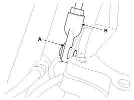
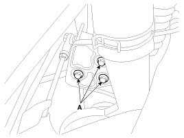
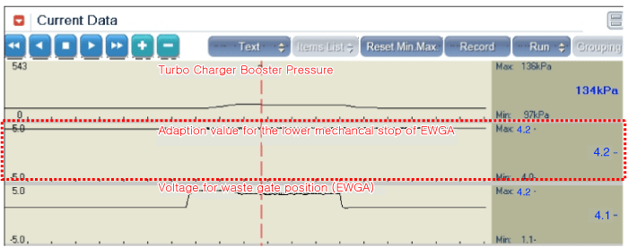
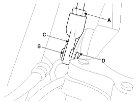
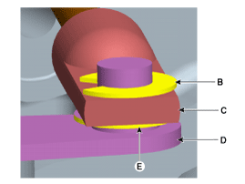

# Kia Sportage: Atuador de Válvula de Resíduo Elétrica (AVE): Procedimentos de Reparo

[Home](../../index.md) / [Manual de Serviço e Reparo do Kia Sportage SL](../sportage-482.md) / [Controle do Motor / Sistema de Combustível](sportage-582.md) / [Sistema de Controle do Motor](sportage-587.md) / Atuador de Válvula de Resíduo Elétrica (AVE): Procedimentos de Reparo

## Inspeção

[Motor]

1. Desligue o interruptor do motor.

2. Desconecte o conector do AVE.

3. Verifique se o AVE está obstruído por material estranho.

4. Mede a resistência entre os terminais de controle do motor (+) e (-).

5. Verifique se a resistência está dentro da especificação.

   ```
   Especificação: Consulte a seção "Especificação".
   ```

[Sensor de Posição]

1. Ligue o interruptor do motor.

2. Conecte o GDS ao conector do link de dados (DLC).

3. Verifique a tensão de saída no sensor de posição do AVE em cada posição dentro da especificação no item de dados atual.

   ```
   Especificação: Consulte a seção "Especificação".
   ```

## Remoção

1. Desligue o interruptor do motor e desconecte o cabo negativo (-) da bateria.

2. Desconecte o conector do AVE (A).

   

3. Remova a montagem do eixo (B) após remover o anel C (A).

   

4. Remova o AVE após remover as varetas (A).

   

   > **Cuidado**
   >
   > - Ao transportar o turbocharger, não segure o eixo do turbocharger para evitar a curvatura do eixo.

## Instalação

1. A instalação é o contrário do procedimento de remoção.

## Ajuste

1. Verifique se o turbocharger de escape é suficientemente frio para funcionar.

2. Gire o interruptor de ignição para a posição OFF.

3. Conecte o equipamento de diagnóstico ao conectador DLC (16 pinos) sob o painel do passageiro.

4. Gire o interruptor de ignição para a posição ON.

   > **Cuidado**
   >
   > - Não inicie o motor.

5. Selecione VIN ou Veículo na tela inicial.

6. Acesse o menu "Engine Control" após selecionar as informações do veículo (Modelo do veículo, Ano do modelo, Tipo do motor) ou inserir o número do VIN.

7. Acesse GDS Engine > Dados Atuais

8. Sem iniciar o motor, cicle a ignição ON por 5 segundos, depois ignição OFF por 5 segundos, e verifique o "Adaptation value para a parada mecânica inferior de EWGA" no GDS.

   Repita este passo até que a mudança no valor de adaptação em relação à ciclo anterior seja inferior a 0,05V.

   > **Nota**
   >
   > - Não inicie o motor. Este é um passo crucial para ler o valor de adaptação correto.

   

9. Se o valor de voltagem medido não estiver dentro do valor de voltagem especificado, ajuste a longitudem do eixo do EWGA. Mas, se não houver, não é necessário procedimento adicional.

   | (1) | Solte o parafuso de bloqueio do eixo (A) e remova o anel C (B). |
   | --- | --- |

   | (2) | Ajuste a parte do eixo (C) girando-a no sentido horário (D) ou no sentido anti-horário (E) para satisfazer a especificação. – Se a voltagem de saída > 4,3 V : Gire no sentido horário (D) – Se a voltagem de saída < 4,1 V : Gire no sentido anti-horário (E) Ângulo de giro Nível de adaptação do valor (V) 0,5 giro (180°) 0,15 ~ 0,20 1 giro (360°) 0,30 ~ 0,40 |
   | --- | --- |
   | – | Se a voltagem de saída > 4,3 V : Gire no sentido horário (D) |
   | – | Se a voltagem de saída < 4,1 V : Gire no sentido anti-horário (E) Ângulo de giro Nível de adaptação do valor (V) 0,5 giro (180°) 0,15 ~ 0,20 1 giro (360°) 0,30 ~ 0,40 |
   | Ângulo de giro | Nível de adaptação do valor (V) |
   | 0,5 giro (180°) | 0,15 ~ 0,20 |
   | 1 giro (360°) | 0,30 ~ 0,40 |

10. Instale a parte do eixo (C) no lembrete do turbocharger (D) temporariamente. Não aperte o parafuso de bloqueio do eixo (A).

11. Gire o interruptor de ignição ON/OFF 5 vezes. Mas mantenha 5 segundos em cada estado IG ON ou IG OFF.

   > **Nota**
   >
   > - Gire o interruptor de ignição ON/OFF repetidamente até que o valor de adaptação "Adaptation value para a parada mecânica inferior de EWGA" esteja dentro de 0,05V.
   > - Quando girar o interruptor de ignição ON ou OFF uma vez, o nível máximo de adaptação do valor: Máx. ± 0,05V

12. Se o valor de voltagem medido não estiver dentro do valor de voltagem especificado, repita os procedimentos 8 a 10 até que o valor de voltagem esteja dentro do valor de voltagem especificado.

   ```
   Valor de voltagem especificado: 4,1 ~ 4,3 V
   ```

13. Verifique se o "Adaptation value para a parada mecânica inferior de EWGA" está dentro do valor de voltagem especificado.

14. Se estiver dentro do valor de voltagem especificado, instale o lembrete do turbocharger (D) e a parte do eixo (C).

   > **Cuidado**

> - Cuide para não remover o selo (E).

15. Apertar o parafuso de bloqueio do extremo do eixo (A). As partes do lado do lembrete do turbocharger (D) e do lado do extremo do eixo (C) devem estar paralelas neste momento.

16. Instalar o anel C (B).




