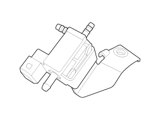

# Kia Sportage: Valvula de Válvula Solenóide de Controle RCV: Descrição e Operação

[Home](../../index.md) / [Manual de Serviço e Reparo do Kia Sportage SL](../sportage-482.md) / [Controle do Motor / Sistema de Combustível](sportage-582.md) / [Sistema de Controle do Motor](sportage-587.md) / Valvula de Válvula Solenóide de Controle RCV: Descrição e Operação

## Descrição

A Valvula de Válvula Solenóide de Controle RCV (Recirculation Valve) é instalada na tubulação de entrada do intercooler e opera o atuador RCV, que controla a passagem de burla do compressor do turbocharger.

Quando o acelerador é fechado, enquanto o motor está em funcionamento a uma rotação de cruzeiro (tip-out), a pressão de boost do turbocharger aumenta rapidamente. A onda de pressão atinge as pás do compressor, causando um ruído de estalo. Para prevenir isso, o ECM abre a valvula de recirculação, permitindo que a pressão de boost excessiva seja ventilada de volta para a parte do limpador de ar do compressor do turbocharger.

