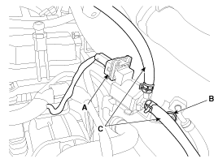

# Kia Sportage: RCV Control Solenoide Valvulina: Procedimentos de Reparo

[Home](../../index.md) / [Manual de Serviço e Reparo do Kia Sportage SL](../sportage-482.md) / [Controle do Motor / Sistema de Combustível](sportage-582.md) / [Sistema de Controle do Motor](sportage-587.md) / Procedimentos de Reparo do RCV Control Solenoide Valvulina

## Inspeção

1. Desligue o interruptor de ignição.

2. Desconecte o conector do RCV control solenoide valvulina.

3. Mede a resistência entre os terminais 1 e 2 do valve.

4. Verifique se a resistência está dentro da especificação.

   ```
   Especificação: Consulte “Especificação”
   ```

## Remoção

1. Desligue o interruptor de ignição e desconecte o cabo negativo (-) da bateria.

2. Remova o RCV control solenoide valvulina após desconectar o conector (A), o parafuso (B) e a mangueira RCV (C).

   

## Instalação

> **Cuidado**
>
> - Não aplique óleo quando a mangueira estiver montada.
> - A mangueira deve ser inserida perfeitamente no bocal.

1. A instalação é o contrário do processo de remoção.

   ```
   Torque para instalação do RCV Control Solenoide Valvulina:
   9,8 ~ 11,8 N.m (1,0 ~ 1,2 kgf.m, 7,2 ~ 8,7 lb-ft)
   ```
