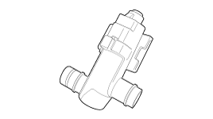

# Kia Sportage: Canister Close Valve (CCV): Descrição e Operação

[Home](../../index.md) / [Manuais de Serviço e Reparo do Kia Sportage SL](../sportage-482.md) / [Controle do Motor / Sistema de Combustível](sportage-582.md) / [Sistema de Controle do Motor](sportage-587.md) / Canister Close Valve (CCV): Descrição e Operação

## Descrição

Canister Close Valve (CCV) está instalado na linha de ventilação do canister. Ele selará o sistema de controle de emissões evaporativas ao fechar o canister da atmosfera quando o sistema de detecção de vazamento estiver operando.

