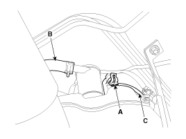
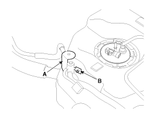
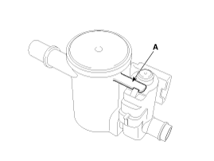
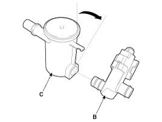

# Kia Sportage: Canister Close Valve (CCV): Procedimentos de Reparo

[Home](../../index.md) / [Manual de Serviço e Reparo do Kia Sportage SL](../sportage-482.md) / [Controle do Motor / Sistema de Combustível](sportage-582.md) / [Sistema de Controle do Motor](sportage-587.md) / Canister Close Valve (CCV): Procedimentos de Reparo

## Inspeção

1. Desligue a chave do motor.

2. Desconecte o conector do CCV.

3. Mede a resistência entre os terminais 1 e 2 do CCV.

4. Verifique se a resistência está dentro da especificação.

   ```
   Especificação: Consulte "Especificação"
   ```

5. Desconecte o tubo de vapor conectado ao canister do CCV.

6. Conecte um pump de vácuo ao bico.

7. Tercele o CCV control line e aplique tensão da bateria à linha de alimentação do CCV.

8. Aplique vácuo e verifique a operação do valve.

   ```
   Especificação: Vácuo mantido
   ```

## Remoção

1. Desligue a chave do motor e desconecte o cabo negativo (-) da bateria.

2. Levante o veículo.

3. Desconecte o conector do canister close valve (A).

4. Desconecte o tubo de ventilação (B, C) do filtro de ar do tanque de combustível e do canister close valve.

   

5. Remova a montagem do filtro de ar do tanque de combustível e do canister close valve (A) após remover o parafuso de montagem (B).

   

6. Libere o lembrete (A), e então separe o canister close valve (B) do filtro de ar do tanque de combustível (C) após girar na direção do seta na figura.

   

   

## Instalação

> **Cuidado**
>
> - Instale o componente com as torques especificados.
> - Tenha em mente que danos internos podem ocorrer se o componente for solto. Se o componente foi solto, inspecione antes de instalar.

1. A instalação é o inverso da remoção.
