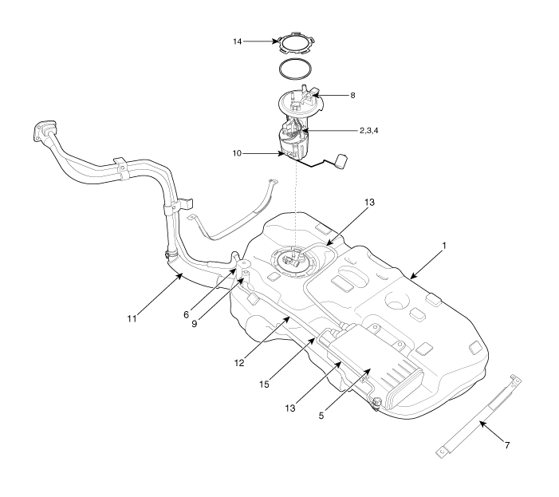
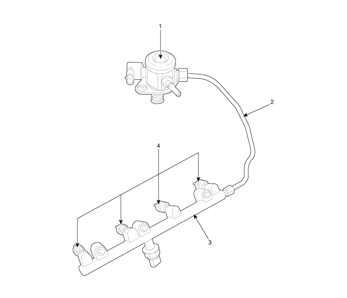

# Kia Sportage: Componentes e Localização dos Componentes

[Home](../../index.md) / [Manual de Serviço e Reparo do Kia Sportage SL](../sportage-482.md) / [Sistema de Controle do Motor / Sistema de Combustível](sportage-582.md) / [Sistema de Entrega de Combustível](sportage-674.md) / Componentes e Localização dos Componentes

## Localização dos Componentes

| 1. Tanque de Combustível 2. Bomba de Combustível 3. Filtro de Combustível 4. Regulador de Pressão de Combustível 5. Canister 6. Filtro de Ar do Tanque de Combustível 7. Aro do Tanque de Combustível | 8. Sensor de Pressão do Tanque de Combustível (FTPS) 9. Valvula de Fechamento do Canister (CCV) 10. Sensor de Nível de Combustível (FLS) 11. Tubo de Enchimento de Combustível 12. Tubo de Ventilação 13. Tubo de Vapores 14. Aro de Bloqueio da Bomba de Combustível |
| --- | --- |

[Pipe de Combustível sob Pressão]

| 1. Bomba de Combustível sob Pressão 2. Tubo de Combustível sob Pressão | 3. Tubo de Entrega 4. Injetor |
| --- | --- |

> **Aviso**
>
> - Em caso de remoção da bomba de combustível sob pressão, tubo de combustível sob pressão, tubo de entrega e injetor, há o risco de lesão causada pela vazamento de combustível sob pressão. Portanto, não realize qualquer trabalho de reparo imediatamente após a parada do motor.
