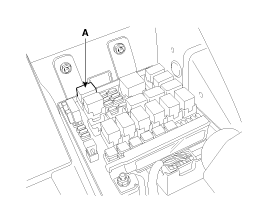

# Kia Sportage: Procedimentos de Reparo

[Home](../../index.md) / [Manual de Serviço e Reparo do Kia Sportage SL](../sportage-482.md) / [Sistema de Controle do Motor / Sistema de Combustível](sportage-582.md) / [Sistema de Entrega de Combustível](sportage-674.md) / Procedimentos de Reparo

## Teste de Pressão do Combustível (Sistema de Pressão Baixa)

1. Libere a pressão residual na linha de combustível (Consulte os Procedimentos de Reparo do Sistema de Entrega de Combustível - "Libere a Pressão Residual na Linha de Combustível").

   > **Cuidado**
   >
   > - Ao remover o relé do bomba de combustível, um Código de Falha Diagnóstico (CFD) pode ocorrer. Exclua o código com o GDS após a conclusão do trabalho de "Liberação da Pressão Residual na Linha de Combustível".

2. Instale a Ferramenta de Serviço Especial (FSE).

   | (1) | Desconecte a tubulação de alimentação de baixa pressão do ponto de entrada de baixa pressão do bomba de alta pressão de combustível. Mesmo após o trabalho de "Liberação da Pressão Residual na Linha de Combustível", pode haver pressão residual, então cubra a conexão do tubo com um pano de trabalho para prevenir a derramagem de combustível antes de desconectar qualquer conexão de combustível. |
   | --- | --- |
   | Mesmo após o trabalho de "Liberação da Pressão Residual na Linha de Combustível", pode haver pressão residual, então cubra a conexão do tubo com um pano de trabalho para prevenir a derramagem de combustível antes de desconectar qualquer conexão de combustível. | |

   | (2) | Instale a ferramenta de serviço especial para medir a pressão do combustível entre a tubulação de alimentação de baixa pressão e o ponto de entrada de baixa pressão do bomba de alta pressão de combustível (Consulte o diagrama abaixo). |
   | --- | --- |

3. Inspeção de vazamento de combustível nas conexões entre a tubulação de alimentação de baixa pressão, o ponto de entrada de baixa pressão do bomba de alta pressão de combustível e os componentes do FSE com o chave de ignição ligada.

4. Medição de Pressão de Combustível.

   ```
   Inicie o motor e mede a pressão de combustível em idle.
   Pressão de Combustível:
   493 ~ 507 kPa (5,0 ~ 5,2 kgf/cm?, 71,5 ~ 73,5 psi)
   Se a pressão de combustível diferir do valor padrão, realize a reparação ou substituição da parte relacionada (Consulte a tabela abaixo).
   ```

   ```
   Pare o motor e, em seguida, verifique a mudança na leitura do indicador de pressão de combustível.
   Valor Padrão: A leitura do indicador deve se manter por cerca de 5 minutos após a parada do motor.
   Se a leitura não se manter, realize a reparação ou substituição da parte relacionada (Consulte a tabela abaixo).
   ```

   | (3) | Desligue a chave de ignição. |
   | --- | --- |

5. Libere a pressão residual na linha de combustível (Consulte os Procedimentos de Reparo do Sistema de Entrega de Combustível - "Liberação da Pressão Residual na Linha de Combustível").

   > **Cuidado**
   >
   > - Ao remover o relé do bomba de combustível, um Código de Falha Diagnóstico (CFD) pode ocorrer. Exclua o código com o GDS após a conclusão do trabalho de "Liberação da Pressão Residual na Linha de Combustível".

6. Fim do Teste

   | (1) | Remova a Ferramenta de Serviço Especial (FSE) da tubulação de alimentação de baixa pressão e do ponto de entrada de baixa pressão do bomba de alta pressão de combustível. |
   | --- | --- |

   | (2) | Conecte a tubulação de alimentação de baixa pressão e o ponto de entrada de baixa pressão do bomba de alta pressão de combustível. |
   | --- | --- |

## Liberar a Pressão Residual na Linha de Combustível

> **Cuidado**
>
> - Sempre que o bomba de combustível de alta pressão, a linha de combustível, a tubulação de entrega ou o injetor for removido imediatamente após desligar o motor, pode ocorrer uma lesão devido à liberação do combustível sob alta pressão. Antes de remover qualquer componente do sistema de combustível sob alta pressão, consulte o "Procedimento para liberação da pressão residual de combustível" abaixo.

> **Nota**
>
> - Use óculos de segurança e luvas resistentes ao combustível.

1. Desligue a ignição e desconecte o cabo negativo da bateria.

2. Remova o relé do bomba de combustível (A).

   

3. Desconecte o conectador elétrico da bomba de combustível de alta pressão.

4. Reconecte o cabo negativo da bateria.

5. Inicie o motor por cerca de 20 segundos para reduzir a pressão nas linhas de alta ou baixa pressão. O motor pode desligar dentro desse período de 20 segundos. Se não desligar, desligue-o.

6. Prosseguir com o serviço ou a reparação. Use panos para cobrir a abertura e capturar gotas quando abrir o sistema de alta pressão.

7. Reinstale/reconecte todos os componentes na ordem inversa de remoção. Inicie o motor e confirme a operação correta, e verifique se não há vazamentos de combustível.

8. Após concluir, limpe os códigos de diagnóstico (DTC) usando o ferramenta de escaneamento GDS (o procedimento acima fará com que os códigos sejam definidos).
