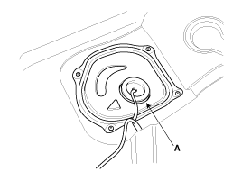
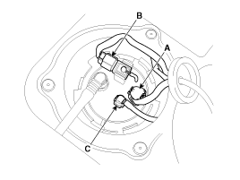
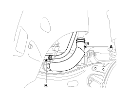
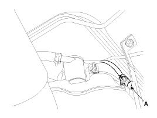
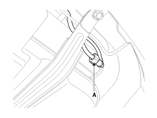
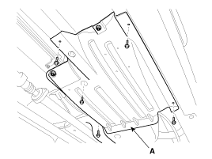
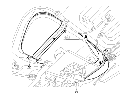

# Kia Sportage: Tanque de Combustível: Procedimentos de Reparo

[Home](../../index.md) / [Manual de Serviço e Reparo do Kia Sportage SL](../sportage-482.md) / [Controle do Motor / Sistema de Combustível](sportage-582.md) / [Sistema de Entrega de Combustível](sportage-674.md) / Procedimentos de Reparo do Tanque de Combustível

## Remoção

1. Libere a pressão residual na linha de combustível (Consulte os Procedimentos de Reparo do Sistema de Entrega de Combustível - "Libere a Pressão Residual na Linha de Combustível").

2. Remova o encosto do assento traseiro (Consulte "Assento" no grupo BD).

3. Remova a capa de serviço do bomba de combustível (A).

   

4. Desconecte o conector do bomba de combustível (A) e o conector do sensor de pressão do tanque de combustível (B).

5. Desconecte o quick-connector da tubulação de alimentação de combustível (C).

   

6. Remova a roda traseira - lateral esquerda e o pneu.

7. Levante o veículo e apoie o tanque de combustível com um garfo.

8. Remova a montagem do silenciador central (Consulte "Sistema de Admissão e Exaustão" no grupo EM).

9. Remova o eixo de transmissão (Consulte "Montagem do Eixo de Transmissão" no grupo DS) [4WD].

10. Desconecte o hosing do tanque de combustível (A) e o hosing de ventilação (B).

   

11. Desconecte o conector do válvula de fechamento do tanque (A).

   

12. Desconecte o quick-connector do tubo de vapor (A).

   

13. Remova a cobertura inferior (A).

   

14. Remova o tanque de combustível do veículo após remover a fita de retenção do tanque (A).

   

   > **Nota**
   >
   > - Ao remover o tanque de combustível, ele deve ser inclinado devido ao intercâmbio com a conexão.

## Instalação

1. A instalação é o inverso da remoção.

   ```
   Parafuso de instalação da fita do tanque de combustível:
   39,2 ~ 54,0 N.m (4,0 ~ 5,5 kgf.m, 28,9 ~ 39,8 lb-ft)
   ```
