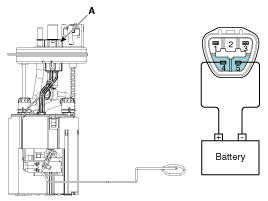
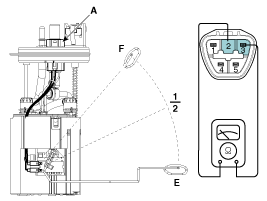
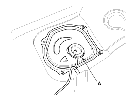
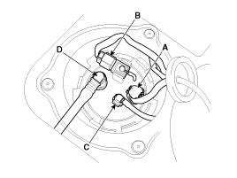
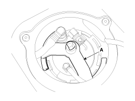
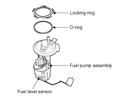

# Kia Sportage: Bomba de Combustível: Procedimentos de Reparo

[Home](../../index.md) / [Manual de Serviço e Reparo do Kia Sportage SL](../sportage-482.md) / [Controle do Motor / Sistema de Combustível](sportage-582.md) / [Sistema de Entrega de Combustível](sportage-674.md) / Procedimentos de Reparo da Bomba de Combustível

## Inspeção

[Bomba de combustível]

1. Desligue o interruptor de ignição, e então remova o cabo do bateriapositivo (-).

2. Remova a montagem da bomba de combustível.

3. Verifique a operação do motor conectando o terminal de alimentação (No.4) e o terminal de terra (No.5) na conexão da bomba de combustível (A).

   

   | Número de Pin | Descrição |
   | --- | --- |
   | 1 | - |
   | 2 | Sinal do envio de combustível |
   | 3 | Terra do envio de combustível |
   | 4 | Motor da bomba de combustível (+) |
   | 5 | Terra do motor da bomba de combustível |

[Envio de combustível]

1. Desligue o interruptor de ignição, e então remova o cabo do bateriapositivo (-).

2. Remova a montagem da bomba de combustível.

3. Usando um ohmmetro, mede a resistência entre os terminais 2 e 3 da conexão do envio de combustível (A) em cada nível do flutuador.

   

   | Número de Pin | Descrição |
   | --- | --- |
   | 1 | - |
   | 2 | Sinal do envio de combustível |
   | 3 | Terra do envio de combustível |
   | 4 | Motor da bomba de combustível (+) |
   | 5 | Terra do motor da bomba de combustível |

4. Verifique também que a resistência muda suavemente quando o flutuador é movido do "E" para o "F".

   | Posição | Resistência(?) | Capacidade (?) |
   | --- | --- | --- |
   | E | 198~202 | 5 |
   | Luz de advertência | 168~172 | 8.5 |
   | 1/2 | 64~68 | 29 |
   | Envio (F) | 6~10 | 55.1 |

## Remoção

1. Libere a pressão residual na linha de combustível (Consulte os Procedimentos de Reparo do Sistema de Entrega de Combustível - "Libere a Pressão Residual na Linha de Combustível").

2. Remova o assento traseiro (Consulte o "Assento" no grupo BD).

3. Remova a capa de serviço da bomba de combustível (A).

   

4. Desconecte a conexão da bomba de combustível (A) e a conexão do sensor de pressão do tanque de combustível (B).

5. Desconecte a conexão rápida do tubo de alimentação do combustível (C) e a conexão rápida do tubo de vapor (D).

   

6. Remova o anel de fixação (A) usando a ferramenta de serviço especial (B) [Nº:09310-2S200].

   

   ```
   Torque de desengate do anel de fixação da bomba de combustível: Mín. 68.65 M.m (Mín. 7 kgf.m, Mín. 50.6 lb-ft)
   ```

7. Remova a bomba de combustível do tanque de combustível.

   

## Instalação

1. A instalação é o inverso da remoção.

   > **Cuidado**
   >
   > - Cuide da direção da bomba de combustível ao instalar (Consulte a vagem no tanque de combustível).
