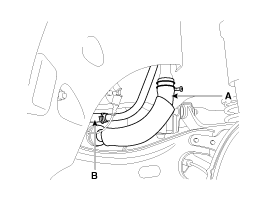
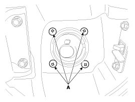
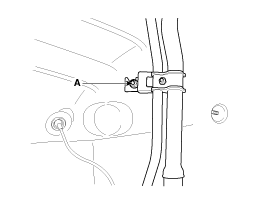

# Kia Sportage: Montagem do Tanque de Combustível: Procedimentos de Reparo

[Home](../../index.md) / [Manual de Serviço e Reparo do Kia Sportage SL](../sportage-482.md) / [Controle do Motor / Sistema de Combustível](sportage-582.md) / [Sistema de Entrega de Combustível](sportage-674.md) / Montagem do Tanque de Combustível: Procedimentos de Reparo

## Remoção

1. Remova a roda traseira-esquerda, pneu e a casa do porta-malas interna.

2. Desconecte a mangueira do tanque de combustível (A) e a mangueira de ventilação (B).

   

3. Abra a porta do tanque de combustível e desafinque o parafuso de montagem do tanque de combustível (A).

   

4. Remova o tanque de combustível do veículo após remover o parafuso de montagem do gancho (A).

   

## Instalação

1. A instalação é o inverso da remoção.

   ```
   Parafuso de montagem do gancho do tanque de combustível:
   3,9 ~ 5,9 N.m (0,4 ~ 0,6 kgf.m, 2,9 ~ 4,3 lb-ft)
   ```
