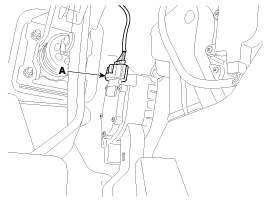
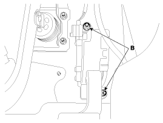
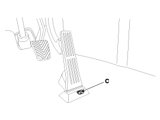

# Kia Sportage: Pedal Acelerador: Procedimentos de Reparo

[Home](../../index.md) / [Manual de Serviço e Reparo do Kia Sportage SL](../sportage-482.md) / [Controle do Motor / Sistema de Combustível](sportage-582.md) / [Sistema de Entrega de Combustível](sportage-674.md) / Procedimentos de Reparo do Pedal Acelerador

## Remoção

1. Desligue a chave do sistema de ignição e desconecte o cabo negativo (-) da bateria.

2. Desconecte o conectador do sensor de posição do pedal acelerador (A).

   

3. Remova as parafusos de instalação (B), o parafuso (C) e, em seguida, remova o módulo do pedal acelerador.

   

   

## Instalação

1. A instalação é o inverso da remoção.

   ```
   Parafuso de instalação do módulo do pedal acelerador:
   16,7 ~ 25,5 N.m (1,7 ~ 2,6 kgf.m, 12,3 ~ 18,8 lb-ft)
   Parafuso de instalação do módulo do pedal acelerador:
   7,8 ~ 11,8 N.m (0,8 ~ 1,2 kgf.m, 5,8 ~ 8,7 lb-ft)
   ```
