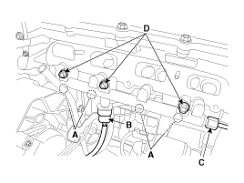
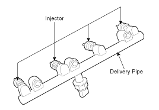
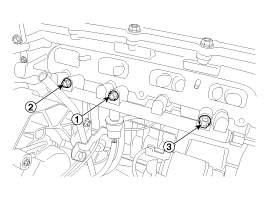

# Kia Sportage: Tubo de Entrega: Procedimentos de Reparo

[Home](../../index.md) / [Manual de Serviço e Reparo do Kia Sportage SL](../sportage-482.md) / [Controle do Motor / Sistema de Combustível](sportage-582.md) / [Sistema de Entrega de Combustível](sportage-674.md) / Procedimentos de Reparo do Tubo de Entrega

## Remoção

> **Aviso**
>
> - Em caso de remoção do bomba de combustível de alta pressão, tubo de alta pressão de combustível, tubo de entrega e injetor, há risco de lesão causada por vazamento de combustível sob alta pressão. Portanto, não realize qualquer trabalho de reparo imediatamente após a parada do motor.

1. Desligue a chave do sistema de ignição e desconecte o cabo negativo (-) da bateria.

2. Libere a pressão residual no sistema de combustível (Consulte os Procedimentos de Reparo do Sistema de Entrega de Combustível - "Liberação da Pressão Residual no Sistema de Combustível").

   > **Cuidado**
   >
   > - Ao remover o relé do bomba de combustível, um Código de Falha Diagnóstico (CFD) pode ocorrer. Exclua o código com o GDS após a conclusão do trabalho de "Liberação da Pressão Residual no Sistema de Combustível".

3. Remova o manifato de admissão (Consulte "Sistema de Admissão e Exaustão" no grupo EM).

4. Desconecte as conexões do injetor (A) e a conexão do sensor de pressão do tubo de alta pressão (B).

5. Remova o tubo de alta pressão de combustível (C).

6. Remova a viga de fixação do injetor (D), e então remova a montagem do tubo de entrega e injetor do motor.

   

   

## Instalação

> **Cuidado**
>
> - Instale o componente com as torques especificadas.

> **Cuidado**
>
> - Aplicar óleo de motor no anel do injetor.
> - Não reutilize o anel do injetor já usado.

> **Cuidado**
>
> - Não reutilize as varetas.

> **Cuidado**
>
> - Ao inserir o injetor, preste atenção para não danificar o cabo do injetor.

> **Cuidado**
>
> - Use ferramentas adequadas para a troca da vedação de combustão. Preste atenção para não danificar a superfície durante a montagem ou desmontagem.

> **Cuidado**
>
> - Evite cair o tubo de combustível (incluindo injetores) ou bater nele em objetos rígidos, pois danos internos podem ocorrer. Se necessário, inspecione visualmente e confirme a operação correta com testes de desempenho antes de reutilizar.
> - Antes de instalar o injetor na cabeça do motor, limpe a abertura do injetor e evite que contaminantes entrem na abertura do injetor. Ao instalar o injetor, evite bater o cabo do injetor em componentes circundantes, pois o cabo pode ser danificado pelo impacto.
> - Ao apertar as três varetas de fixação do tubo de entrega de combustível, aperte manualmente primeiro, e então aperte na sequência correta ( > > ) em várias etapas até a torção especificada. O tubo de entrega deve se mover menos que 1/8 polegada (aproximadamente 3mm) sempre que cada vareta for apertada.



1. A instalação é o inverso da remoção.

   ```
   Vareta de fixação do tubo de entrega:
   18,6 ~ 23,5 N.m (1,9 ~ 2,4 kgf.m, 13,7 ~ 17,4 lb-ft)
   Vareta de fixação do tubo de alta pressão de combustível:
   26,5 ~ 32,4 N.m (2,7 ~ 3,3 kgf.m, 19,5 ~ 23,9 lb-ft)
   ```
