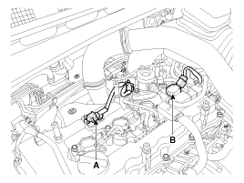
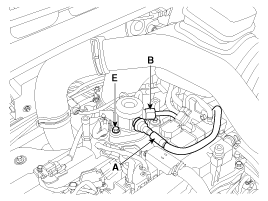
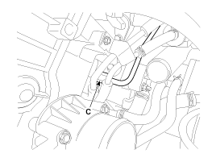
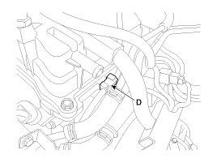
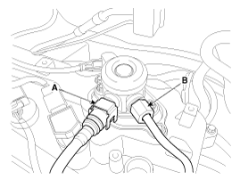
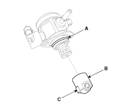
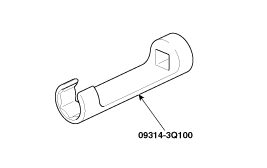

# Kia Sportage: Bomba de Combustível sob Pressão Alta: Procedimentos de Reparo

[Home](../../index.md) / [Manual de Serviço e Reparo do Kia Sportage SL](../sportage-482.md) / [Controle do Motor / Sistema de Combustível](sportage-582.md) / [Sistema de Entrega de Combustível](sportage-674.md) / Procedimentos de Reparo da Bomba de Combustível sob Pressão Alta

## Remoção

> **Aviso**
>
> - Em caso de remoção da bomba de combustível sob pressão alta, tubo de entrega de combustível e injetores, há risco de lesão causada por vazamento de combustível sob pressão. Portanto, não realize nenhuma reparação imediatamente após a parada do motor.

1. Desligue a chave do ignição e desconecte o cabo negativo (-) da bateria.

2. Libere a pressão residual no tubo de combustível (Consulte os Procedimentos de Reparo do Sistema de Entrega de Combustível - "Liberação da Pressão Residual no Tubo de Combustível").

   > **Cuidado**
   >
   > - Ao remover o relé da bomba de combustível, pode ocorrer um Código de Falha Diagnóstico (CFD).
   > - Exclua o código com o GDS após a conclusão do trabalho de "Liberação da Pressão Residual no Tubo de Combustível".

3. Remova o limpador de carburador e o tubo de admissão de ar (Consulte o "Sistema de Admissão e Exaustão" no grupo EM).

4. Desconecte a conexão do regulador de pressão do tubo de combustível (A).

5. Desconecte a conexão rápida do tubo de alimentação do bobina de ignição (B).

   

6. Desconecte a conexão rápida do tubo de alimentação do combustível (A).

7. Remova o tubo de combustível sob pressão alta.

   | (1) | Remova o parafuso de instalação (B) da bomba de combustível sob pressão alta com a ferramenta especial de serviço [Nº de SST: 09314-3Q100] |
   | --- | --- |

   | (2) | Remova o parafuso de instalação (C) do tubo de entrega com a ferramenta especial de serviço [Nº de SST: 09314-3Q100] |
   | --- | --- |

   | (3) | Remova o solenoide de controle de purga (Consulte o "Solenoide de Controle de Purga" neste grupo). |
   | --- | --- |

   | (4) | Remova o bloco de função (D), e então remova o tubo de combustível sob pressão alta. |
   | --- | --- |

8. Remova os parafusos de instalação (E), e então remova a bomba de combustível sob pressão alta do conjunto do cabeçote do cilindro.

   > **Cuidado**
   >
   > - Desenrosque alternadamente os dois parafusos em pequenos passos (0,5 voltas). Em caso de desenroscar completamente um dos dois parafusos com o outro instalado, a superfície do cabeçote do cilindro pode ser quebrada devido à tensão da mola da bomba.

   

   

   

## Instalação

> **Aviso**
>
> - Verifique se a conexão rápida da mangueira de baixa pressão de combustível (A) está completamente conectada ao bomba de alta pressão de combustível até ouvir um som de "click".
> - Verifique novamente a conexão da mangueira de baixa pressão de combustível com a bomba de alta pressão de combustível após a conexão, puxando-a.
> - Instale a mangueira de alta pressão de combustível (B) com as torques especificadas.
> - Porque uma fuga de combustível pode causar um incêndio, inspecione com segurança as conexões de todas as mangueiras de combustível no estado de partida do motor.



> **Cuidado**
>
> - Antes de instalar a bomba de alta pressão de combustível, posicione o tappete do rolamento na posição mais baixa girando o eixo do crankshaft. Caso contrário, os parafusos de instalação podem quebrar devido à tensão da mola da bomba.

> **Cuidado**
>
> - Não reutilize os parafusos usados.

> **Cuidado**
>
> - Não reutilize a mangueira de alta pressão de combustível usada.

> **Cuidado**
>
> - Ao apertar os parafusos de instalação da bomba de alta pressão de combustível, aperte-os em ordem, passo a passo (0,5 voltas) após apertá-los com a chave de torque manual.

> **Cuidado**
>
> - Instale o componente com as torques especificadas.
> - Primeiramente, aperte os parafusos ou parafusos de forma manual até que não possam ser apertados mais para que eles sejam posicionados corretamente, e depois aperte-os completamente até a torção especificada usando uma chave de torque.
> - Se não apertar os parafusos ou parafusos em linha reta com as fendas ou conexões correspondentes, pode ocorrer uma fuga de combustível devido a quebras nas threading.

> **Cuidado**
>
> - Note que danos internos podem ocorrer se o componente for caído. Neste caso, use-o após a inspeção.

> **Cuidado**
>
> - Lubrifique o anel de vedação (A) da bomba de alta pressão de combustível, o tappete do rolamento (B) e a projeção (C). Lubrifique também o sulco na localização onde a projeção (C) é instalada.



1. A instalação é o contrário da remoção.

   > **Nota**
   >
   > - Use a ferramenta especial de serviço [SST Número: 09314-3Q100] para instalar a mangueira de alta pressão de combustível.

   

   ```
   Parafuso de instalação da bomba de alta pressão de combustível: 12,8 ~ 14,7 N.m (1,3 ~ 1,5 kgf.m, 9,4 ~ 10,9 lb-ft)
   Parafuso de instalação da mangueira de alta pressão de combustível: 26,5 ~ 32,4 N.m (2,7 ~ 3,3 kgf.m, 19,5 ~ 23,9 lb-ft)
   Parafuso de instalação do bloco de função da mangueira de alta pressão de combustível: 7,8 ~ 11,8 N.m (0,8 ~ 1,2 kgf.m, 5,8 ~ 8,7 lb-ft)
   ```
