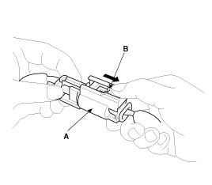
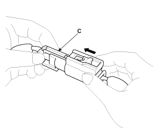

# Informações Gerais de Segurança e Cautela do Kia Sportage: SL

[Início](../../index.md) / [Manual de Serviço e Reparo do Kia Sportage SL](../sportage-482.md) / [Restrição](sportage-848.md) / Informações Gerais de Segurança e Cautela

## Precauções

Precauções Gerais

Por favor, leia as seguintes precauções cuidadosamente antes de realizar o serviço do sistema de airbag.

Observe as instruções descritas neste manual, ou os airbags podem acionar acidentalmente e causar danos ou ferimentos.

| • | Exceto quando realizando inspeções elétricas, sempre desligue
o interruptor de ignição e desconecte o cabo negativo da bateria, e aguarde pelo menos três minutos antes de começar o trabalho. |
| --- | --- |

> **Nota**
>
> - Os conteúdos na memória não são apagados mesmo se o interruptor de ignição for desligado ou se os cabos da bateria forem desconectados da bateria.

| • | Use peças de substituição que são fabricadas às mesmas especificações e qualidade que as peças originais. Não instale peças SRS usadas de outro veículo. Use apenas peças novas quando realizar reparos no SRS. |
| --- | --- |

| • | Inspeção cuidadosa de qualquer peça SRS antes de instalá-la. Não instale nenhuma peça que mostre sinais de ter caído ou sido manipulada incorretamente, como arranhões, rachaduras ou deformações. |
| --- | --- |

| • | Antes de remover qualquer uma das peças SRSCM (incluindo a desconexão dos conectores), sempre desconecte o conector SRSCM. |
| --- | --- |

Manuseio e Armazenamento do Airbag

Não desmonte os airbags; eles não possuem peças servíveis. Uma vez que um airbag tenha sido acionado, ele não pode ser reparado ou reutilizado.

Para o armazenamento temporário do airbag durante o serviço, observe as seguintes precauções.

| • | Armazene o airbag removido com a superfície do pufe para cima. |
| --- | --- |

| • | Mantenha longe de óleo, graxa, detergente ou água para prevenir danos ao conjunto do airbag. |
| --- | --- |

| • | Armazene o airbag removido em superfície sólida e plana longe de qualquer fonte de calor alta (excedendo 85 C/185 F). |
| --- | --- |

| • | Nunca realize inspeções elétricas no airbag, como medição de resistência. |
| --- | --- |

| • | Não se posicione na frente do conjunto do airbag durante a remoção, inspeção ou substituição. |
| --- | --- |

| • | Consulte as instruções de descarte para o descarte do airbag danificado. |
| --- | --- |

| • | Seja cuidadoso para não bater ou impactar o módulo SRS ou os sensores laterais ou frontais de impacto quando o interruptor de ignição estiver ligado, aguarde pelo menos três minutos após o interruptor de ignição ser desligado antes de começar o trabalho. |
| --- | --- |

| • | Durante a instalação ou substituição, seja cuidadoso para não bater (por impacto com ferrautes, martelo, etc.) na área ao redor do módulo SRS e dos sensores laterais e frontais de impacto. Os airbags podem acionar acidentalmente e causar danos ou ferimentos. |
| --- | --- |

| • | Substitua o módulo do airbag frontal, SRSCM, FIS quando o airbag frontal for acionado. Substitua o fio do airbag quando o fio do airbag for danificado. Substitua o módulo do airbag lateral, módulo do airbag de cortina, SRSCM, SIS quando o airbag lateral for acionado. Substitua o airbag quando o fio do airbag for danificado. |
| --- | --- |

| • | Após colisão em que o airbag ou os airbags laterais foram acionados |
| --- | --- |

did não se deslocado, inspecione para verificar qualquer dano ou deformação na unidade SRS e nos sensores laterais. Se houver algum dano, substitua a unidade SRS, o sensor de impacto frontal e/ou os sensores laterais. |
| --- | --- |

| • | Não desmonte a unidade SRS, o sensor de impacto frontal ou os sensores laterais. |
| --- | --- |

| • | Desligue o interruptor de ignição, desconecte o cabo negativo da bateria e aguarde pelo menos três minutos antes de iniciar a instalação ou substituição da unidade SRS. |
| --- | --- |

| • | Certifique-se de que a unidade SRS, o sensor de impacto frontal e os sensores laterais estejam instalados firmemente com os parafusos de montagem. |
| --- | --- |

| • | Não derrame água ou óleo na unidade SRS, ou nos sensores de impacto frontal ou laterais e mantenha-os longe de poeira. |
| --- | --- |

| • | Armazene a unidade SRS, o sensor de impacto frontal e os sensores laterais laterais em área fresca (15 ~ 25°C/ 59 ~ 77°F) e seca (30 ~ 80% de umidade relativa, sem umidade). |
| --- | --- |

Cautelas de Conexões Elétricas

A conexão SRS pode ser identificada por cobertura externa especial de cor amarela. Observe as instruções descritas nesta seção.

| • | Nunca tente modificar, entrelaçar ou reparar as conexões SRS. Se houver um fio aberto ou danificado nas conexões SRS, substitua o fio de alimentação. |
| --- | --- |

| • | Certifique-se de que as fios do fio de alimentação estejam instalados de forma que não estejam comprimidos ou interfiram em outras partes. |
| --- | --- |

| • | Certifique-se de que todas as localizações de terra do SRS estejam limpas e que as conexões de terra estejam firmemente fixadas para garantir contato metálico metálico. Uma terra inadequada pode causar problemas intermitentes que são difíceis de diagnosticar. |
| --- | --- |

Conector de Bloqueio com Mola

Alguns conectores do sistema SRS têm um bloqueio com mola.

Conector do Airbag

Desconectar

Para liberar o bloqueio, puxe a parte móvel do conector (A) e o slider (B), mantendo a outra metade do conector.

Separe as metades do conector. Certifique-se de puxar a parte móvel e não a metade do conector.

Conectar

Segure ambas as metades do conector e pressione firmemente até que a projeção (C) do conector do slider clique para bloquear.

