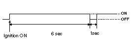
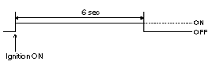
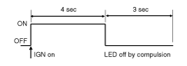

# Kia Sportage: Descrição e Operação

[Início](../../index.md) / [Manual de Serviço e Reparo do Kia Sportage SL](../sportage-482.md) / [Restrição](sportage-848.md) / Descrição e Operação

## Aviso de Lampada

Comportamento da Lampada de Aviso após a Ligação do Ignição

Assim que a tensão de operação for aplicada à entrada de ignição do SRSCM, o SRSCM ativa a lampada de aviso para verificar a operação da LED.

A lampada deve se acender por 6 segundos durante a fase de inicialização e depois se apagar.

No entanto, para indicar ao motorista, a lampada de aviso deve se acender por 6 segundos e se apagar por 1 segundo, e então se manter acendendo continuamente se existir qualquer falha ativa.

1. Falha ativa.

   

2. Falha normal ou histórica apenas.

   

3. Quando se liga o interruptor de ignição durante o modo de codificação variante (EOL), a lampada de airbag é acionada e piscada a cada 1 segundo até que a codificação seja concluída.

   Se a codificação variante for concluída normalmente, a lampada de airbag se acenderá por 6 segundos e depois se apagará. Caso contrário, a lampada de airbag piscará continuamente a cada 1 segundo.

   | (1) | Se a codificação variante for concluída normalmente |
   | --- | --- |

   | (2) | Se a codificação variante não for concluída |
   | --- | --- |

   Quando houver uma falha ativa no sistema de airbag ou uma falha interna no SRSCM, a codificação variante (EOL) não pode ser concluída. Neste caso, realize a procedimento de codificação variante (EOL) novamente após o reparo com o GDS.

Ativação Independente da Lampada de Aviso do SRSCM

Existem certas condições de falha em que o SRSCM não pode funcionar e, portanto, não pode controlar a operação da lampada de aviso padrão. Nesses casos, a lampada de aviso padrão é ativada diretamente pela circuitaria apropriada que opera independentemente do SRSCM. Esses casos são:

1. Perda da alimentação da bateria para o SRSCM: a lampada de aviso se mantém acendendo continuamente.

2. Perda da tensão interna de operação: a lampada de aviso se mantém acendendo continuamente.

3. Perda da operação do microprocessador: a lampada de aviso se mantém acendendo continuamente.

4. SRSCM não conectado: a lampada de aviso se mantém acendendo continuamente.

Ativação da Lampada Telltale

A Lampada Telltale indica o status ativo ou desativado do Airbag do Passageiro (PAB) com base no status do assento do passageiro. Se o assento do passageiro estiver vazio ou ocupado com um criança (ou cadeirinha), o Airbag do Passageiro é desativado e a Lampada Telltale é acionada para informar ao motorista que o PAB está desativado. Assim que a tensão de operação for aplicada à entrada de ignição do SRSCM, o SRSCM ativa a prova de funcionamento da lampada telltale.

Depois de ligar o ignição, a lampada telltale deve se acender por 4 segundos e se apagar por 3 segundos durante a fase de inicialização e se manter apagada até que seja recebido um mensagem de habilitação válida do sistema PODS.

