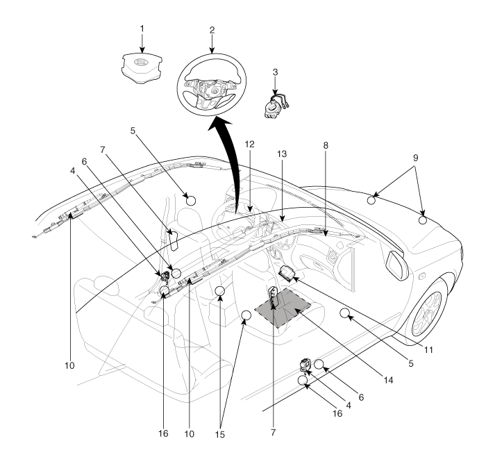
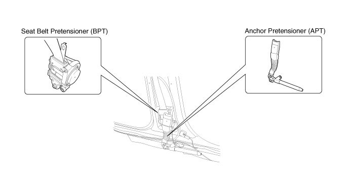
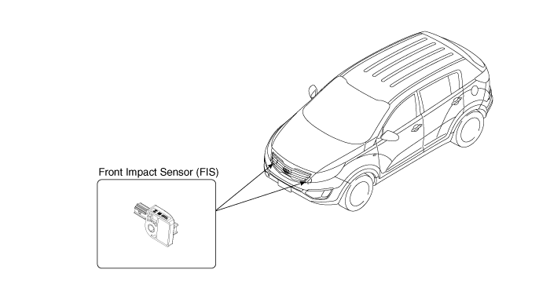
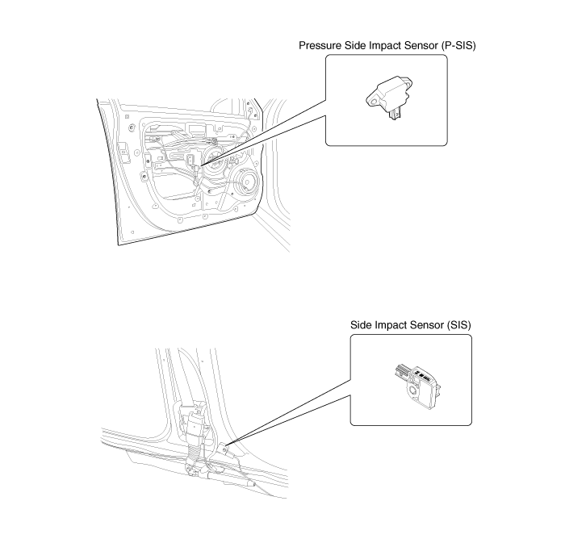

# Kia Sportage: Componentes e Localização dos Componentes

[Home](../../index.md) / [Manual de Serviço e Reparo do Kia Sportage SL](../sportage-482.md) / [Sistema de Restrição](sportage-848.md) / Componentes e Localização dos Componentes

## Componentes

| 1. Airbag do Motorista (DAB) 2. Volante 3. Fita do Relógio 4. Pretensores de Cinto de Segurança (BPT) 5. Sensor de Impacto Lateral do Lado do Motorista (P-SIS) 6. Sensor de Impacto Lateral (SIS) 7. Airbag do Lado (SAB) 8. Airbag do Passageiro (PAB) | 9. Sensor de Impacto Frontal (FIS) 10. Airbag de Teto (CAB) 11. Módulo de Controle do Sistema de Restrição Adicional (SRSCM) 12. Lâmpada de Aviso do Airbag 13. Lâmpada de Indicação 14. Sistema de Detecção do Passageiro (PODS) 15. Sensor de Tensão do Cinto de Segurança 16. Pretensores de Anilha (APT) |
| --- | --- |

## Localização dos Componentes

Módulo de Controle do Sistema de Restrição Adicional (SRSCM)

Airbag do Motorista (DAB) / Airbag do Passageiro (PAB)

Airbag do Lado (SAB)

Airbag de Teto (CAB)

Pretensores de Cinto de Segurança (BPT)/ Pretensores de Anilha (APT)

Sensor de Impacto Frontal (FIS)

Sensor de Impacto Lateral (SIS)

