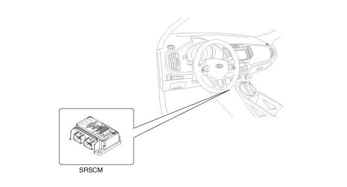
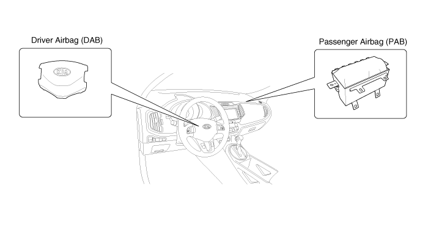
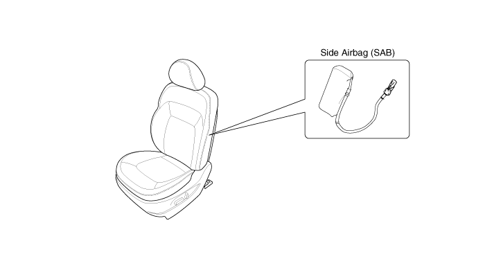
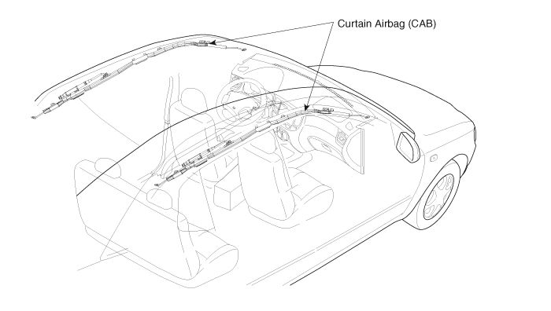

# Sistema de Restrição — Componentes e localização

[Home](../../index.md) / [Manual de Serviço e Reparo](../sportage-482.md) / [Sistema de Restrição](sportage-848.md) / Componentes e localização

## Diagrama — Componentes

## Legenda — Componentes

| Nº | Componente |
| --- | --- |
| 1 | Airbag do Motorista (DAB) |
| 2 | Volante |
| 3 | Fita do Relógio |
| 4 | Pretensores de Cinto de Segurança (BPT) |
| 5 | Sensor de Impacto Lateral do Lado do Motorista (P-SIS) |
| 6 | Sensor de Impacto Lateral (SIS) |
| 7 | Airbag do Lado (SAB) |
| 8 | Airbag do Passageiro (PAB) |
| 9 | Sensor de Impacto Frontal (FIS) |
| 10 | Airbag de Teto (CAB) |
| 11 | Módulo de Controle do Sistema de Restrição Adicional (SRSCM) |
| 12 | Lâmpada de Aviso do Airbag |
| 13 | Lâmpada de Indicação |
| 14 | Sistema de Detecção do Passageiro (PODS) |
| 15 | Sensor de Tensão do Cinto de Segurança |
| 16 | Pretensores de Anilha (APT) |

## Diagrama — Localização

Módulo de Controle do Sistema de Restrição Adicional (SRSCM)

Airbag do Motorista (DAB) / Airbag do Passageiro (PAB)

Airbag do Lado (SAB)

Airbag de Teto (CAB)

Pretensores de Cinto de Segurança (BPT)/ Pretensores de Anilha (APT)

Sensor de Impacto Frontal (FIS)

Sensor de Impacto Lateral (SIS)
