# Kia Sportage: Módulo de Controle do SRS (SRSCM): Procedimentos de Reparo

[Home](../../index.md) / [Manual de Serviço e Reparo do Kia Sportage SL](../sportage-482.md) / [Restrição](sportage-848.md) / [SRSCM](sportage-856.md) / Procedimentos de Reparo do Módulo de Controle do SRS (SRSCM)

## Remoção

1. Remova a chave do ignição do veículo.

2. Desconecte o cabo negativo da bateria e aguarde pelo menos três minutos antes de começar o trabalho.

3. Desconecte os conectores DAB, PAB, SAB, CAB e BPT.

4. Remova o capô superior do console do chão. (Consulte o grupo do corpo - console)

5. Remova a montagem do manopla de troca de marcha. (Consulte o grupo do transaxle - manopla de troca de marcha)

6. Empurre o trinco (1) para frente e, em seguida, puxe o trinco (3) após pressionar o trinco do travamento (2).

   Desconecte o conectores do módulo de controle do sistema de airbag. (A e B)

   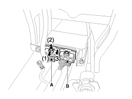

7. Remova as parafusos de montagem (3EA) do SRSCM, em seguida, remova o SRSCM.

   > **Cuidado**
   >
   > - Você deve remover ou instalar o SRSCM com o travamento do ignição desligado, pois o SRSCM possui função de detecção de capotamento. SAB, CAB, BPT podem ser desplegados se você agitar o SRSCM na direção de cima e baixo ou para a direita e esquerda com o travamento do ignição ligado.

## Instalação

1. Remova a chave do ignição do veículo.

2. Desconecte o cabo negativo da bateria e aguarde pelo menos três minutos antes de começar o trabalho.

3. Instale o SRSCM com os parafusos de montagem do SRSCM.

   ```
   Torque de aperto:
   6,8 ~ 9,2 N.m (0,7 ~ 0,9 kgf.m, 5,0 ~ 6,8 lb-ft)
   ```

   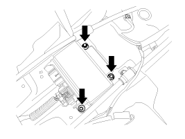

   > **Nota**
   >
   > - Use novos parafusos de montagem quando substituir o SRSCM após um acidente.

4. Conecte o conectores do SRSCM.

5. Instale a montagem do manopla de troca de marcha. (Consulte o grupo do transaxle - manopla de troca de marcha)

6. Instale o capô superior do console do chão. (Consulte o grupo do corpo - console)

7. Conecte os conectores DAB, PAB, SAB, CAB e BPT.

8. Reconecte o cabo negativo da bateria.

9. Confirme a operação correta do sistema após a instalação do SRSCM:

   | • | Ligue o travamento do ignição; a luz do indicador do SRS deve se acender por cerca de seis segundos e depois se apagar. |
   | --- | --- |

   > **Cuidado**
   >
   > - O SRSCM pode detectar um capotamento do veículo. SAB, CAB, BPT podem ser desplegados se o mecânico mover o SRSCM no veículo durante o estado do travamento do ignição ligado. Por isso, certifique-se de desligar o travamento do ignição e, em seguida, remover o SRSCM do veículo.

## Codificação de Variante

Após substituir a SRSCM por uma nova, o procedimento de "Codificação de Variante" deve ser realizado.

> **Nota**
>
> - No modo de codificação de variante da SRSCM, o lampiño do airbag está piscando periodicamente (ON: 0,5s., OFF: 0,5s.) até que a codificação seja concluída normalmente.
> - Se a codificação de variante falhar, será exibido o DTC B1762 (Erro de Codificação do ACU) e o lampiño do airbag será acionado.
> - Neste caso, realize o procedimento de codificação de variante novamente após confirmar a causa em "Informações de Estado do DTC".
> - A codificação de variante pode ser realizada até 255 vezes, mas se o número de trabalhos de codificação exceder 255, será exibido o DTC B1683 (Excesso do Número Máximo de Codificação) e a SRSCM deve ser substituída.
> - Se a tensão da bateria for baixa (menor que 9V), será exibido o DTC B1102. Neste caso, recarregue a bateria antes de qualquer outra coisa e, em seguida, realize o procedimento de codificação de variante.
> - O DTC B1762 (Erro de Codificação do ACU) e B1102 (Tensão da Bateria Baixa) podem ser exibidos simultaneamente.

Procedimento de Codificação de Variante

?nbsp; Tipo On-Line no GDS

1. Ignição "OFF", conecte o GDS.

2. Ignição "ON" & Motor "OFF", selecione o nome do veículo e o sistema do airbag.

3. Selecione o modo de codificação de variante.

4. Segue os passos na tela conforme abaixo.

1) Tela inicial de codificação de variante do ACU

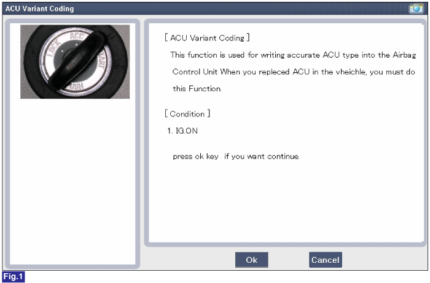

2) Tela de entrada do código VIN

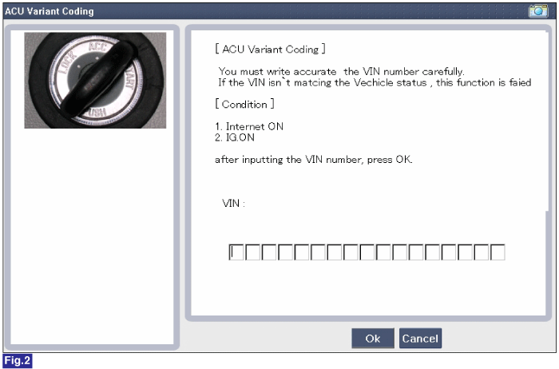

3) Tela de progresso da codificação de variante - 1


4) Tela de progresso da codificação de variante - 2

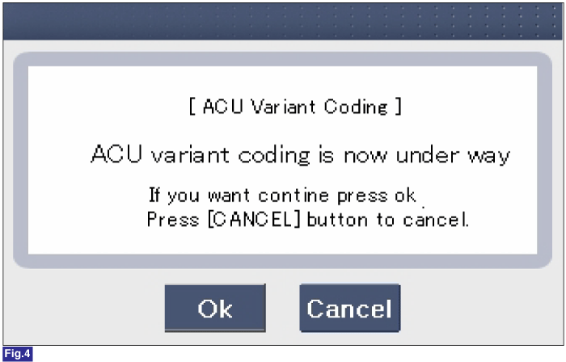

5) Codificação de variante concluída

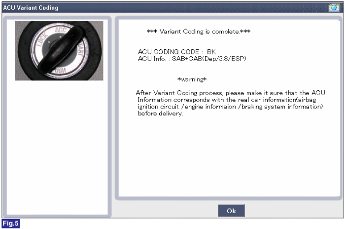

> **Nota**
>
> - 1) Esta tela é aberta quando você tenta realizar a codificação de variante novamente na SRSCM que já tenha realizado a codificação de variante.
> - 2) Tela de falha de comunicação

?nbsp; Tipo Off-Line no GDS (Isso pode ser usado quando não há conexão com a internet)

1) Tela inicial de codificação de variante do ACU

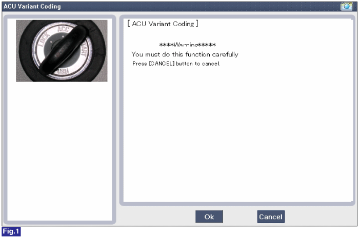

2) Tela de entrada do código de codificação do ACU

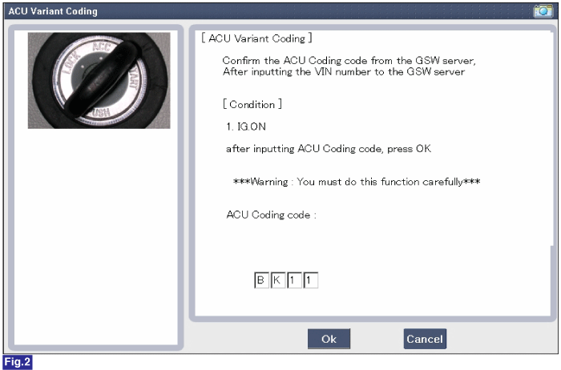

3) Tela de reconfirmação da entrada do código de codificação do ACU

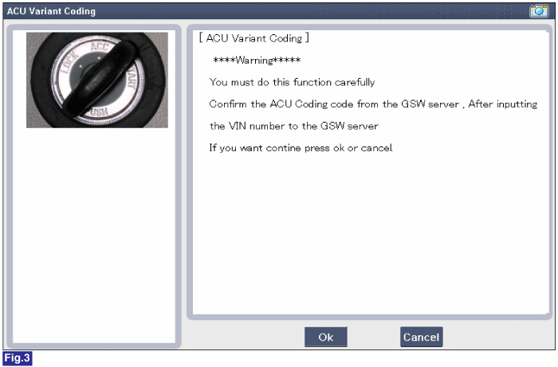

4) Tela de progresso da codificação de variante - 1

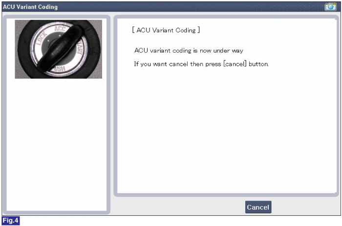

5) Tela de progresso da codificação de variante - 2

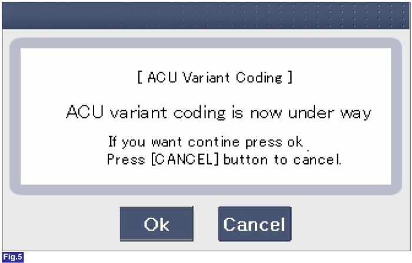

6) Codificação de variante concluída

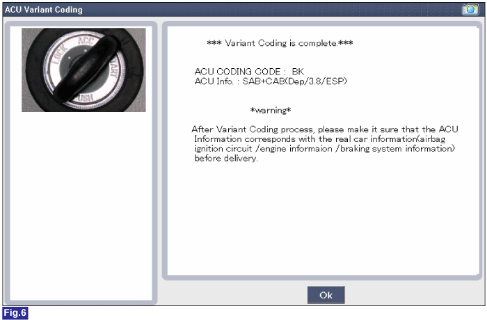

> **Nota**
>
> - 1) Esta tela é aberta quando você tenta realizar a codificação de variante novamente na SRSCM que já tenha realizado a codificação de variante.
