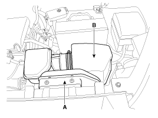
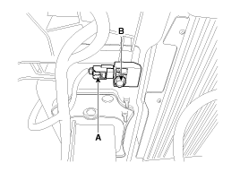

# Kia Sportage: Sensor de Impacto Frontal (SIF): Procedimentos de Reparo

[Home](../../index.md) / [Manual de Serviço e Reparo do Kia Sportage SL](../sportage-482.md) / [Restrição](sportage-848.md) / [SRSCM](sportage-856.md) / Sensor de Impacto Frontal (SIF): Procedimentos de Reparo

## Remoção

> **Cuidado**
>
> - A remoção do airbag deve ser realizada de acordo com as precauções/procedimentos descritos anteriormente.
> - Antes de desconectar o conector do sensor de impacto frontal, desconecte o(s) conector(es) do airbag frontal.
> - Não ligue o interruptor de ignição e não conecte o cabo do baterija durante a substituição do sensor de impacto frontal.

1. Desconecte o cabo negativo da baterija e aguarde pelo menos três minutos antes de começar o trabalho.

2. Remova o dutos de ar (A) e a montagem do filtro de ar (B). (Apenas para o sensor de impacto frontal do passageiro)

   

3. Desconecte o conector do sensor de impacto frontal (A).

   

4. Remova a parafuso de montagem do sensor de impacto frontal (B).

5. Remova o sensor de impacto frontal.

## Instalação

> **Cuidado**
>
> - Não ligue o interruptor de ignição e não entre em contato com o cabo da baterija durante a substituição do sensor de impacto frontal.

1. Instale o novo sensor de impacto frontal.

2. Ajuste o parafuso de montagem do sensor de impacto frontal.

   ```
   Torque de aperto :
   7,0 ~ 9,0 Nm (0,7 ~ 0,9 kgf.m, 5,1 ~ 6,6 lb.ft)
   ```

3. Conecte o conector do sensor de impacto frontal.

4. Instale o dutos de ar e a montagem do filtro de ar. (Apenas para o sensor de impacto frontal do passageiro)

5. Reconecte o cabo negativo da baterija.

6. Após a instalação do Sensor de Impacto Frontal, confirme a operação correta do sistema:

   | • | Ligue o interruptor de ignição; a luz do indicador do SRS deve acender por cerca de seis segundos e depois apagar. |
