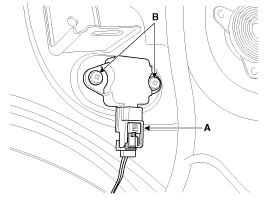
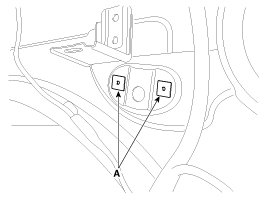
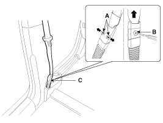
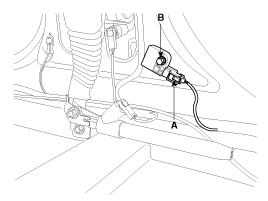

# Kia Sportage: Sensor de Impacto Lateral (SIS): Procedimentos de Reparo

[Home](../../index.md) / [Manual de Serviço e Reparo do Kia Sportage SL](../sportage-482.md) / [Restrição](sportage-848.md) / [SRSCM](sportage-856.md) / Sensor de Impacto Lateral (SIS): Procedimentos de Reparo

## Remoção

Sensor de Impacto Lateral com Pressão

> **Cuidado**
>
> - A remoção do airbag deve ser realizada de acordo com as precauções/procedimentos descritos anteriormente.
> - Antes de desconectar o conector do sensor de impacto lateral, desconecte o conector do airbag lateral.
> - Não ligue o interruptor de ignição e não conecte a bateria durante a substituição do sensor de impacto lateral.

1. Desconecte o cabo negativo da bateria e aguarde pelo menos três minutos antes de começar o trabalho.

2. Remova o trim da porta dianteira. (Consulte o grupo do Corpo - Trimmagem da Porta)

3. Desconecte o conector do sensor de impacto lateral frontal (A) e remova as parafusos de montagem do sensor de impacto lateral frontal (B).

   

4. Remova os grommetes de parafuso (A).

   

Sensor de Impacto Lateral

1. Desconecte o cabo negativo da bateria e aguarde pelo menos três minutos antes de começar o trabalho.

2. Para remover o anclagem do cinto de segurança (C), mantenha os pinos de bloqueio (A) empurrando na direção indicada. Em seguida, remova o cinto de segurança após empurrar o pino de bloqueio (B).

   

3. Remova o trim do para-choque da porta. (Consulte o grupo do Corpo - Trimmagem Interna)

4. Remova o trim do pilar central. (Consulte o grupo do Corpo - Trimmagem Interna)

5. Desconecte o conector do sensor de impacto lateral (A).

   

6. Ajuste o parafuso de montagem do sensor de impacto lateral (B) e remova o sensor de impacto lateral.

## Instalação

Sensor de Impacto Lateral

> **Cuidado**
>
> - Não ligue o interruptor de ignição e não conecte o cabo da bateria durante a substituição do sensor de impacto lateral.

1. Instale os grompos de parafusos (A).

   

   > **Cuidado**
   >
   > - Não reutilize os grompos de parafusos (A) ao instalar.

2. Instale o novo sensor de impacto frontal com os parafusos e, em seguida, conecte o conector do sensor de impacto lateral sob pressão.

   ```
   Torque de aperto:
   1,1 ~ 1,3 N.m (0,11 ~ 0,13 kgf.m, 0,7 ~ 1,0 lb-ft)
   ```

3. Instale o trim da porta frontal. (Consulte o grupo do corpo - Trimmagem da porta frontal)

4. Insira a cinta do assento no anclador do pretenso.

   > **Nota**
   >
   > - Certifique-se de que o gancho de bloqueio está conectado corretamente.

5. Reconecte o cabo negativo da bateria.

6. Após a instalação do sensor de impacto frontal, confirme a operação correta do sistema:

   | • | Ligue o interruptor de ignição; a luz do indicador SRS deve acender por cerca de seis segundos e, em seguida, apagar. |
   | --- | --- |

   > **Cuidado**
   >
   > - Você deve seguir o torque de aperto especificado porque
   os Sensores de Impacto Lateral sob Pressão (P-SIS) podem quebrar ou os grompos de parafusos podem se deslocar.
   > - Problemas podem ocorrer na durabilidade dos P-SIS ou na depreciação do desempenho de detecção de impacto se os grompos de parafusos se deslocarem.
   > - O módulo da porta não deve ser deformado porque o SRSCM julga um impacto através do sensor de pressão no módulo da porta.

Sensor de Impacto Lateral

> **Cuidado**
>
> - Não ligue o interruptor de ignição e não conecte o cabo da bateria durante a substituição do sensor de impacto lateral.

1. Instale o novo sensor de impacto lateral com a viga e, em seguida, conecte o conector do sensor de impacto lateral.

   ```
   Torque de aperto:
   7,0 ~ 9,0 N.m (0,7 ~ 0,9 kgf.m, 5,1 ~ 6,6 lb-ft)
   ```

2. Instale o trim do pilar central (Consulte o grupo do corpo - Trimmagem interna)

3. Instale o trim do para-choque da porta. (Consulte o grupo do corpo - Trimmagem interna)

4. Insira a cinta do assento no anclador do pretenso.

5. Reconecte o cabo negativo da bateria.

6. Após a instalação do Sensor de Impacto Lateral, confirme a operação correta do sistema:

   | • | Ligue o interruptor de ignição; a luz do indicador SRS deve acender por cerca de seis segundos e, em seguida, apagar. |
   | --- | --- |
