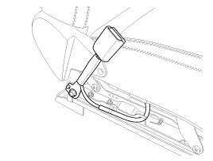

# Kia Sportage: Botão do Cinto de Segurança (BS): Procedimentos de Reparo

[Home](../../index.md) / [Manual de Serviço e Reparo do Kia Sportage SL](../sportage-482.md) / [Restrição](sportage-848.md) / [SRSCM](sportage-856.md) / Botão do Cinto de Segurança (BS): Procedimentos de Reparo

## Remoção

1. Desconecte o cabo negativo da bateria, e aguarde pelo menos três minutos antes de começar o trabalho.

2. Remova a montagem do assento dianteiro. (Consulte o grupo Corpo - Assento dianteiro)

3. Desloque o parafuso de montagem do botão do cinto de segurança e remova o botão do cinto de segurança.

   

## Instalação

> **Cuidado**
>
> - Certifique-se de que as mangueiras do cinto de segurança não estejam presas ou interferindo com outras partes.

1. Remova a chave do ignição do veículo.

2. Desconecte o cabo negativo da bateria, e aguarde pelo menos três minutos antes de começar o trabalho.

3. Instale o botão do cinto de segurança.

   ```
   Torque de Aperto :
   39,2 ~ 53,9 N.m (4,0 ~ 5,5 kgf.m, 28,9 ~ 39,8 lb-ft)
   ```

4. Instale a montagem do assento dianteiro. (Consulte o grupo Corpo - Assento dianteiro)

5. Reconecte o cabo negativo da bateria.

6. Após a instalação do botão do cinto de segurança, confirme a operação correta do sistema:

   | • | Ligue o interruptor do ignição; o indicador SRS deve acender por cerca de seis segundos e depois apagar. |
   | --- | --- |
