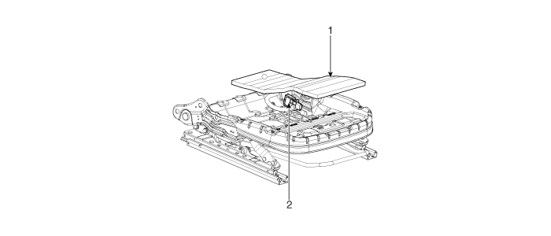

# Sistema de Detecção de Ocupaantes Passivos (PODS) — Componentes e localização

[Home](../../index.md) / [Manual de Serviço e Reparo](../sportage-482.md) / [Restrição](sportage-848.md) / [SRSCM](sportage-856.md) / Componentes e localização

## Diagrama

## Legenda

| Nº | Componente |
| --- | --- |
| 1 | Matriz de sensores |
| 2 | Unidade de PODS |
