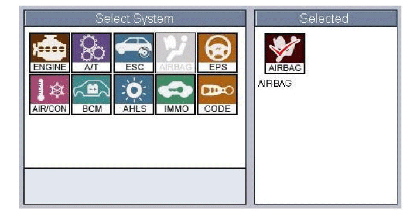
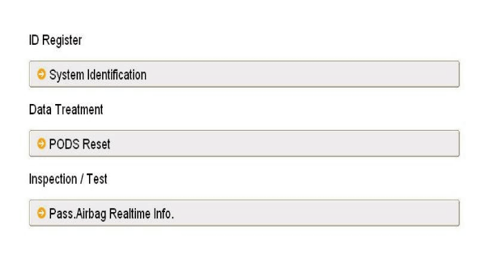
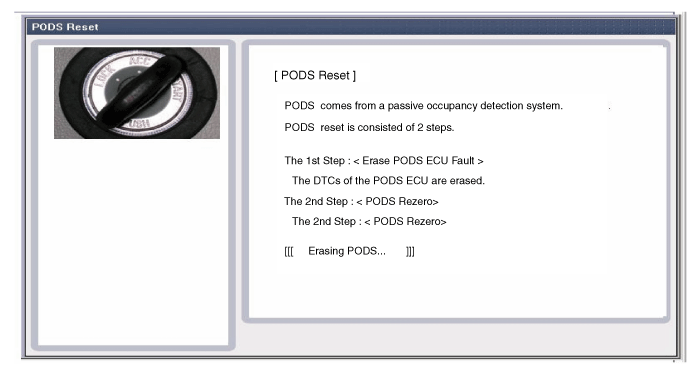
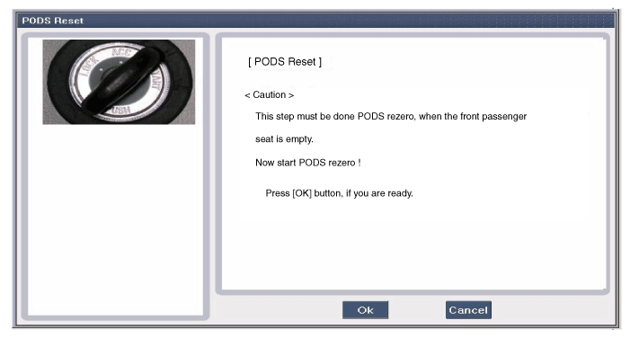
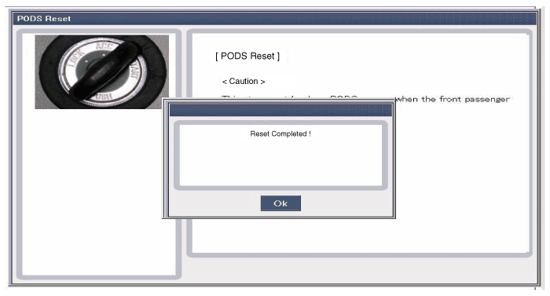
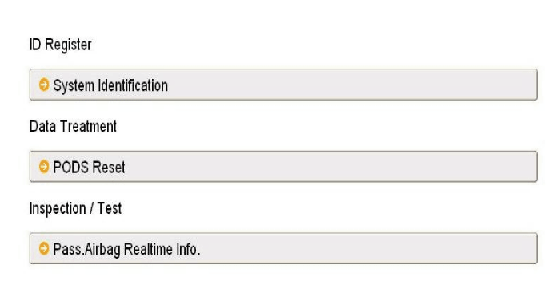
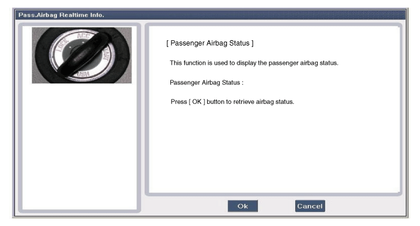
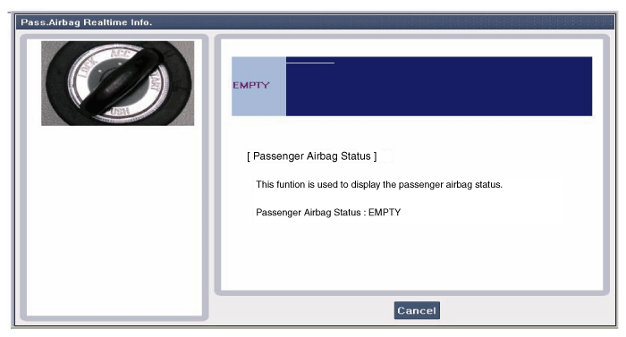
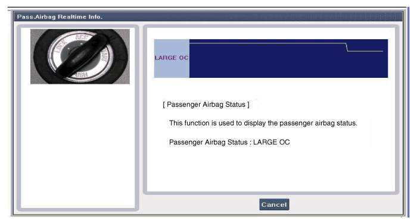
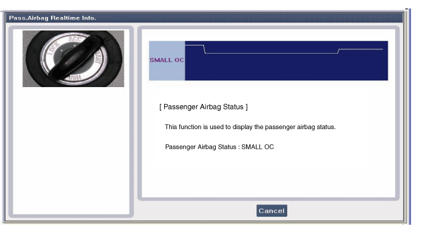

# Kia Sportage: Sistema de Detecção de Passageiros Ativos (SDPA): Procedimentos de Reparo

[Home](../../index.md) / [Manual de Serviço e Reparo do Kia Sportage SL](../sportage-482.md) / [Restrição](sportage-848.md) / [SRSCM](sportage-856.md) / Sistema de Detecção de Passageiros Ativos (SDPA): Procedimentos de Reparo

## Remoção

1. Desconecte o cabo negativo da bateria, e aguarde pelo menos três minutos antes de começar o trabalho.

2. Remova a montagem do assento do passageiro dianteiro. (Consulte o grupo Corpo - Assento)

3. Remova o encosto do assento como montagem. (Consulte o grupo Corpo - Assento)

## Instalação

1. Instale a montagem do assento do passageiro dianteiro equipado com SDPA. (Consulte o grupo Corpo - Assento)

2. Instale a montagem do assento do passageiro dianteiro.

   (Consulte o grupo Corpo - assento)

3. Reconecte o cabo negativo da bateria.

4. Após a instalação do SDPA, confirme a operação correta do sistema:

   | • | Ligue o interruptor do acionamento da ignição; o indicador do SRS deve se acender por cerca de seis segundos e depois se apagar. |
   | --- | --- |

   O indicador do telltale acenderá por 4 segundos e se apagará por 3 segundos. Após os 7 segundos, permanecerá apagado se o SDPA não precisar ser suprimido e o airbag do passageiro estiver ativado.

   > **Nota**
   >
   > - Certifique-se de realizar o reset do SDPA com o scantool após a substituição da montagem do assento do passageiro equipada com SDPA.

## Procedimento de Re-zero do SDPA

Você deve realizar o procedimento de re-zero do SDPA após a manutenção ou substituição de qualquer parte do assento do passageiro.

1. Ignição “OFF”, conecte GDS.

2. Ignição “ON” & Motor “OFF”, selecione o sistema de airbag e o modo “Reset SDPA”.

   

   

3. O GDS mostrará as duas etapas de reset do SDPA.

   | (1) | Exclua os códigos de diagnóstico do SDPA. |
   | --- | --- |

   | (2) | Inicialização do SDPA. Esta etapa deve ser realizada durante o re-zero do SDPA, quando o assento do passageiro dianteiro estiver vazio. |
   | --- | --- |
   | Esta etapa deve ser realizada durante o re-zero do SDPA, quando o assento do passageiro dianteiro estiver vazio. | |

4. Pressione o botão OK para excluir os códigos de diagnóstico relacionados ao SDPA.

   

5. Pressione o botão OK para inicializar o SDPA.

   

   > **Cautela**
   >
   > - Esta etapa deve ser realizada durante o re-zero do SDPA, quando o assento do passageiro dianteiro estiver vazio.

6. O procedimento de inicialização do SDPA será realizado.

   

7. Verifique a situação do SDPA selecionando "Informações do Airbag do Passageiro em Tempo Real" após o procedimento de reset do SDPA.

   

8. Realize a verificação pressionando o botão OK.

   

9. Conclua o procedimento pressionando o botão Cancelar se não houver problemas após a verificação de cada status.

   

   

   
