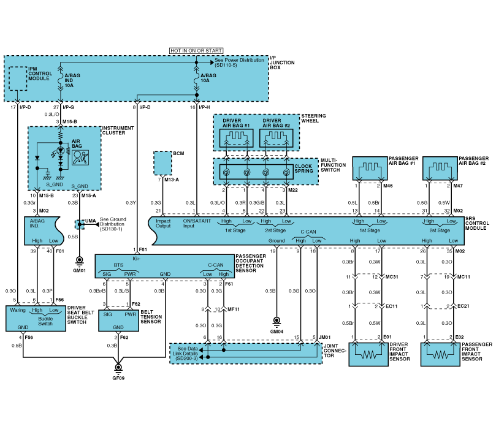
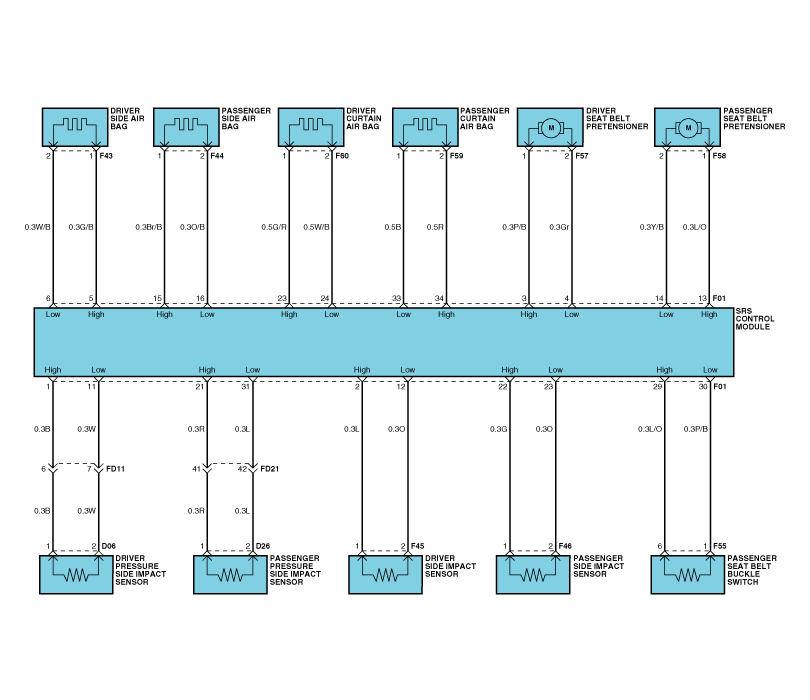
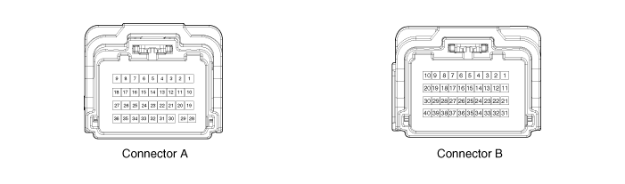

# Kia Sportage: Diagramas Esquemáticos

[Home](../../index.md) / [Manual de Serviço e Reparo do Kia Sportage SL](../sportage-482.md) / [Restrição](sportage-848.md) / [SRSCM](sportage-856.md) / Diagramas Esquemáticos

## Diagrama de Circuito (1)

Diagrama de Circuito (2)

## Conector do Acessório

| Pin | Função (Conector A) | Pin | Função (Conector A) |
| --- | --- | --- | --- |
| 1 | Ignição | 1 | Sensor de Impacto Lateral [Motorista] Positivo |
| 2 | - | 2 | Sensor de Impacto Lateral [Motorista] Positivo |
| 3 | Luz de Aviso do Airbag | 3 | Pretensores de Cinto de Segurança [Motorista] Positivo |
| 4 | (1º estágio) Airbag do Motorista Positivo | 4 | Pretensores de Cinto de Segurança [Motorista] Negativo |
| 5 | (1º estágio) Airbag do Motorista Negativo | 5 | Airbag Lateral [Motorista] Positivo |
| 6 | - | 6 | Airbag Lateral [Motorista] Negativo |
| 7 | - | 7 | - |
| 8 | Sensor de Impacto Frontal [Motorista] Positivo | 8 | - |
| 9 | CAN_High | 9 | - |
| 10 | - | 10 | - |
| 11 | - | 11 | Sensor de Impacto Lateral [Motorista] Negativo |
| 12 | Luz de Aviso do Telltale | 12 | Sensor de Impacto Lateral [Motorista] Negativo |
| 13 | (1º estágio) Airbag do Passageiro Positivo | 13 | Pretensores de Cinto de Segurança [Passageiro] Positivo |
| 14 | (1º estágio) Airbag do Passageiro Negativo | 14 | Pretensores de Cinto de Segurança [Passageiro] Negativo |
| 15 | - | 15 | Airbag Lateral [Passageiro] Positivo |
| 16 | - | 16 | Airbag Lateral [Passageiro] Negativo |
| 17 | Sensor de Impacto Frontal [Motorista] Negativo | 17 | - |
| 18 | CAN_Low | 18 | - |
| 19 | Terreno | 19 | - |
| 20 | - | 20 | - |
| 21 | Saída de Colisão | 21 | Sensor de Impacto Lateral [Passageiro] Positivo |
| 22 | (2º estágio) Airbag do Motorista Positivo | 22 | Sensor de Impacto Lateral [Passageiro] Positivo |
| 23 | (2º estágio) Airbag do Motorista Negativo | 23 | Airbag de Teto [Motorista] Positivo |
| 24 | - | 24 | Airbag de Teto [Motorista] Negativo |
| 25 | - | 25 | Pretensores de Cinto de Segurança [Motorista] Positivo |
| 26 | Sensor de Impacto Frontal [Passageiro] Positivo | 26 | Pretensores de Cinto de Segurança [Motorista] Negativo |
| 27 | - | 27 | - |
| 28 | - | 28 | - |
| 29 | - | 29 | Interruptor do Cinto de Segurança [Passageiro] Positivo |
| 30 | Interface de Aviso do Cinto de Segurança [Passageiro] | 30 | Interruptor do Cinto de Segurança [Passageiro] Negativo |
| 31 | (2º estágio) Airbag do Passageiro Positivo | 31 | Sensor de Impacto Lateral [Passageiro] Negativo |
| 32 | (2º estágio) Airbag do Passageiro Negativo | 32 | Sensor de Impacto Lateral [Passageiro] Negativo |
| 33 | - | 33 | Airbag de Teto [Passageiro] Positivo |
| 34 | - | 34 | Airbag de Teto [Passageiro] Negativo |
| 35 | Sensor de Impacto Frontal [Passageiro] Negativo | 35 | Pretensores de Cinto de Segurança [Passageiro] Positivo |
| 36 | - | 36 | Pretensores de Cinto de Segurança [Passageiro] Negativo |
| ? | ? | 37 | - |
| ? | ? | 38 | - |
| ? | ? | 39 | Interruptor do Cinto de Segurança [Motorista] Positivo |
| ? | ? | 40 | Interruptor do Cinto de Segurança [Motorista] Negativo |
