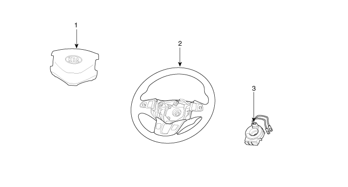

# Módulo do Airbag do Motorista (DAB) e Bobina do Cronômetro — Componentes e localização

[Home](../../index.md) / [Manual de Serviço e Reparo](../sportage-482.md) / [Restrição](sportage-848.md) / [Módulo do Airbag](sportage-873.md) / Componentes e localização

## Diagrama

## Legenda

| Nº | Componente |
| --- | --- |
| 1 | Módulo do Airbag do Motorista (DAB) |
| 2 | Volante |
| 3 | Bobina do Cronômetro |
