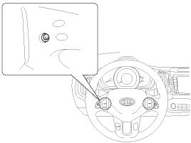
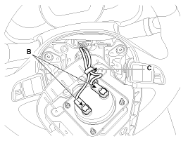
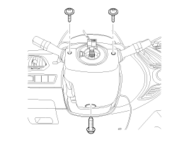
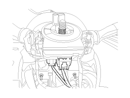
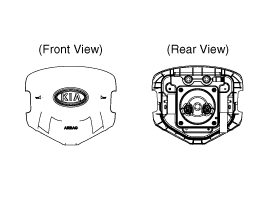
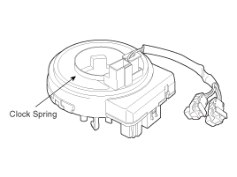

# Kia Sportage: Módulo do Airbag do Motorista (DAB) e Bobina do Cronómetro: Procedimentos de Reparo

[Home](../../index.md) / [Manual de Serviço e Reparo do Kia Sportage SL](../sportage-482.md) / [Sistema de Restrição](sportage-848.md) / [Módulo do Airbag](sportage-873.md) / Módulo do Airbag do Motorista (DAB) e Bobina do Cronómetro: Procedimentos de Reparo

## Remoção

1. Alinhe os pneus dianteiros com o centro do volante antes de remover o volante.

   > **Cuidado**
   >
   > - Se o volante e os pneus dianteiros não estiverem alinhados juntos, isso afeta o número de circulação do volante e o cabo dentro da bobina do cronómetro pode ser danificado.

2. Desconecte o cabo negativo da bateria.

   > **Nota**
   >
   > - Após desconectar o cabo negativo da bateria, aguarde pelo menos trinta segundos.

3. Remova as parafusos de montagem do módulo do airbag (2 unidades).

   

4. Remova o clip de fixação das fiação (C), e, em seguida, libere o gancho de bloqueio do conector para desconectar o conector do módulo do airbag do motorista (B).

   

   > **Cuidado**
   >
   > - O módulo do airbag removido deve ser armazenado em um local limpo e seco com a capa do amortecedor voltada para cima.

5. Remova o volante e a capa do volante.

   

   (Consulte o grupo do Sistema de Direção - Coluna e Shaft do Volante)

6. Desconecte o conector e a bobina do cronómetro do sinaleiro, e, em seguida, remova a bobina do cronómetro.

   

## Inspeção

Módulo do Airbag do Motorista (DAB)

Se qualquer peça inadequada for encontrada durante a inspeção a seguir, substitua o módulo do airbag por um novo.

> **Cuidado**
   >
   > - Nunca tente medir a resistência da circunferência do módulo do airbag (squib) mesmo se você estiver usando o teste especificado. Se a resistência da circunferência do módulo do airbag for medida com um teste, a acidental detonação do airbag resultará em lesões pessoais graves.

1. Verifique a capa do amortecedor para dentes, rachaduras ou deformidades.

2. Verifique o módulo do airbag para dentes, rachaduras ou deformidades.

3. Verifique os ganchos e conectores para danos, terminais para deformidades e fiação para amarrões.

4. Verifique a caixa do inflador do airbag para dentes, rachaduras ou deformidades.

   

5. Instale o módulo do airbag no volante para verificar a alinhamento com o volante.

Bobina do Cronómetro

1. Se, como resultado das verificações a seguir, até um único ponto anormal for descoberto, substitua a bobina do cronómetro por uma nova.

2. Verifique os conectores e a tubulação de proteção para danos, e os terminais para deformidades.

   

## Instalação

Para o volante sem fio de aquecimento

1. Alinhe os pneus dianteiros na posição neutra antes de montar o volante.

   > **Cuidado**
   >
   > - Se o volante e os pneus dianteiros não forem alinhados na posição neutra juntos, afeta o número de revoluções do volante e o cabo dentro do molas-pêndulo pode ser danificado.

2. Desconecte o cabo negativo da bateria.

   > **Observação**
   >
   > - Após desconectar o cabo negativo da bateria, aguarde pelo menos trinta segundos.

3. Alinhe o molas-pêndulo no centro antes de montá-lo no volante.

   > **Cuidado**
   >
   > - O pin central (A) está preso no molas-pêndulo e está alinhado no centro.
   > - O pin central (A) deve ser removido após a montagem do molas-pêndulo no volante.
   > - O pin central (A) não deve ser removido até a montagem completa do molas-pêndulo.

4. Se o pin central já foi removido, alinhe o molas-pêndulo no centro seguindo o procedimento a seguir.

   | (1) | Vire o molas-pêndulo no sentido horário até o ponto de parada |
   | --- | --- |

   | (2) | 2 revoluções no sentido anti-horário. |
   | --- | --- |

   | (3) | Verifique o indicador laranja no molas-pêndulo. |
   | --- | --- |

5. Conecte o conectador do molas-pêndulo e o conectador do buzina ao molas-pêndulo.

6. Monte o capuz do eixo do volante e o volante. (Consulte o grupo Sistema de Direção - Eixo do Volante)

7. Monte o molas-pêndulo e o módulo do Airbag do Motorista (DAB). (Consulte o grupo Sistema de Direção - Eixo do Volante)

8. Fixe o módulo do Airbag do Motorista (DAB) com as novas varetas de fixação.

   ```
   Torque de aperto:
   7,8 ~ 10,8 Nm (0,8 ~ 1,1 kgf.m, 5,8 ~ 8,0 lb.ft)
   ```

   

9. Conecte o cabo negativo da bateria.

10. Após a montagem do airbag, confirme a operação do sistema.

    > **Observação**
    >
    > - Ligue o interruptor de ignição; a luz do indicador do SRS deve acender por cerca de seis segundos e depois apagar.
    > - Verifique se o buzina funciona.

Para o volante com fio de aquecimento

1. Alinhe os pneus dianteiros na posição neutra antes de montar o volante.

   > **Cuidado**
   >
   > - Se o volante e os pneus dianteiros não forem alinhados na posição neutra juntos, afeta o número de revoluções do volante e o cabo dentro do molas-pêndulo pode ser danificado.

2. Desconecte o cabo negativo da bateria.

   > **Observação**
   >
   > - Após desconectar o cabo negativo da bateria, aguarde pelo menos trinta segundos.

3. Alinhe o molas-pêndulo no centro antes de montá-lo no volante.

   > **Cuidado**
   >
   > - O pin central (A) está preso no molas-pêndulo e está alinhado no centro.
   > - O pin central (A) deve ser removido após a montagem do molas-pêndulo no volante.
   > - O pin central (A) não deve ser removido até a montagem completa do molas-pêndulo.

4. Se o pin central já estiver removido, posicione o molaspring no centro com o seguinte procedimento.

   | (1) | Vire o molaspring no sentido horário até o parada |
   | --- | --- |

   | (2) | Vire 2 revoluções no sentido anti-horário. |
   | --- | --- |

   | (3) | Certifique-se de posicionar a marca (??). |
   | --- | --- |

5. Conecte o conectador do harness do molaspring e o conectador do harness do buzina ao molaspring.

6. Instale a cobertura do volante e o volante. (Consulte o grupo Sistema de Direção - Coluna de Direção e Braço de Direção)

7. Conecte o conectador do módulo do Airbag do Motorista (DAB) e, em seguida, instale o módulo do Airbag do Motorista (DAB) no volante.

8. Fixe o Airbag do Motorista (DAB) com as novas varetas de fixação.

   ```
   Torque de aperto:
   7,8 ~ 10,8 Nm (0,8 ~ 1,1 kgf.m, 5,8 ~ 8,0 lb.ft)
   ```

   

9. Conecte o cabo negativo da bateria.

10. Após a instalação do airbag, confirme a operação correta do sistema.

   > **Nota**
   >
   > - Ligue o interruptor de ignição; a luz do indicador SRS deve acender por cerca de seis segundos e depois apagar.
   > - Certifique-se de que o buzina funcione.
