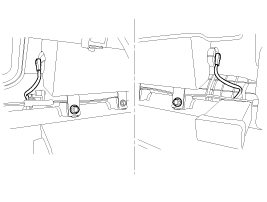
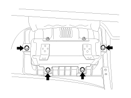

# Kia Sportage: Módulo do Airbag do Passageiro (PAB): Procedimentos de Reparo

[Home](../../index.md) / [Manual de Serviço e Reparo do Kia Sportage SL](../sportage-482.md) / [Restrição](sportage-848.md) / [Módulo do Airbag](sportage-873.md) / Módulo do Airbag do Passageiro (PAB): Procedimentos de Reparo

## Remoção

1. Desconecte o cabo negativo da bateria e aguarde pelo menos trinta segundos antes de começar o trabalho.

2. Remova o adorno do tapete de impacto. (Consulte o grupo do Corpo - tapete de impacto).

3. Desconecte o conector do airbag do passageiro e remova o parafuso de montagem do PAB.

   

4. Remova o tapete de impacto. (Consulte o grupo do Corpo - tapete de impacto).

   > **Nota**
   >
   > - Substitua o tapete de impacto que foi danificado durante a ativação do PAB.

5. Remova o dutos do aquecedor do tapete de impacto.

6. Remova as varetas de montagem (4UN) do tapete de impacto. Em seguida, remova o airbag do passageiro.

   > **Cuidado**
   >
   > - O módulo do airbag removido deve ser armazenado em um local limpo e seco com a almofada do airbag para cima.

## Instalação

1. Remova a chave do motor do veículo.

2. Desconecte o cabo negativo da bateria e aguarde pelo menos trinta segundos antes de começar o trabalho.

3. Coloque um airbag do passageiro no tapete de impacto e aperte os parafusos de montagem do airbag do passageiro.

   ```
   Torque de aperto:
   5,9 ~ 6,9 N.m (0,6 ~ 0,7 kgf.m, 4,3 ~ 5,1 lb-ft)
   ```

   

4. Instale o dutos do aquecedor no tapete de impacto.

5. Instale o tapete de impacto. (Consulte o grupo do Corpo - tapete de impacto)

6. Aperte os parafusos de montagem do airbag do passageiro.

   ```
   Torque de aperto:
   18,6 ~ 26,5 N.m (1,9 ~ 2,7 kgf.m, 13,7 ~ 19,2 lb-ft)
   ```

7. Conecte o conector do harness do airbag do passageiro ao conector principal do SRS.

8. Reinstale o adorno do tapete de impacto. (Consulte o grupo do Corpo - tapete de impacto)

9. Reconecte o cabo negativo da bateria.

10. Após a instalação do airbag do passageiro (PAB), confirme a operação correta do sistema:

    | • | Ligue o interruptor do motor; a luz do indicador do SRS deve se acender por cerca de seis segundos e depois se apagar. |
