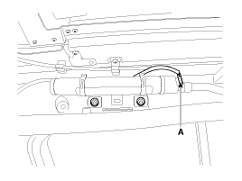

# Kia Sportage: Módulo de Airbag de Teto (BAT)

[Home](../../index.md) / [Manual de Serviço e Reparo do Kia Sportage SL](../sportage-482.md) / [Restrição](sportage-848.md) / [Módulo de Airbag](sportage-873.md) / Módulo de Airbag de Teto (BAT): Procedimentos de Reparo

## Remoção

1. Desconecte o cabo negativo da bateria e aguarde pelo menos trinta segundos antes de iniciar o trabalho.

2. Remova o acabamento do teto. (Consulte o grupo Corpo - Interior)

3. Desconecte o conectador do cabo de alimentação do airbag de teto (A).

   

4. Depois de soltar os parafusos e parafusos de montagem, remova o airbag de teto.

## Instalação

1. Remova a chave do motor do veículo.

2. Desconecte o cabo negativo da bateria e aguarde pelo menos trinta segundos.

3. Ajuste os parafusos de montagem do airbag de teto.

   ```
   Torque de aperto:
   7,0 ~ 9,0 N.m (0,7 ~ 0,9 kgf.m, 5,1 ~ 6,6 lb-ft)
   ```

   > **Cuidado**
   >
   > - Nunca torça o módulo de airbag ao instalá-lo. Se o módulo for torcido, o módulo de airbag pode operar de forma anormal.

4. Conecte o conectador do airbag de teto.

5. Instale o acabamento do teto. (Consulte o grupo Corpo - Interior)

6. Reconecte o cabo negativo da bateria.

7. Após a instalação do airbag de teto (BAT), confirme a operação correta do sistema:

   | • | Ligue o interruptor do motor; a luz do indicador SRS deve se acender por cerca de seis segundos e depois se apagar. |
