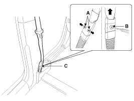
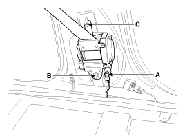

# Kia Sportage: Pretensador de Cinto de Segurança (BPT): Procedimentos de Reparo

[Home](../../index.md) / [Manual de Serviço e Reparo do Kia Sportage SL](../sportage-482.md) / [Restrição](sportage-848.md) / [Pretensador de Cinto de Segurança](sportage-887.md) / Pretensador de Cinto de Segurança (BPT): Procedimentos de Reparo

## Remoção

1. Desconecte o cabo negativo da bateria, e aguarde pelo menos trinta segundos antes de começar o trabalho.

2. Para remover o pretensador de cinto de segurança do banco (C), mantenha a pressão nos pinos de bloqueio (A) na direção setada. Em seguida, remova o cinto de segurança após empurrar o pino de bloqueio (B).

   

3. Remova as seguintes peças. (Consulte o grupo Corpo - Trim Interno)

   | – | Trim da porta |
   | --- | --- |

   | – | Trim do pilar central |
   | --- | --- |

4. Remova o parafuso superior do anclamento.

5. Desconecte o conector do pretensador de cinto de segurança (A).

   

6. Desenrole o parafuso de montagem do pretensador de cinto de segurança (B, C) e remova o pretensador de cinto de segurança.

## Instalação

1. Remova a chave do motor do veículo.

2. Desconecte o cabo negativo da bateria e aguarde pelo menos trinta segundos.

3. Instale o pretensador de cinto de segurança (BPT) com um parafuso.

   ```
   Torque de aperto:
   Parafuso B: 39,2 ~ 53,9 N.m (4,0 ~ 5,5 kgf.m, 28,9 ~ 39,8 lb-ft)
   ```

4. Conecte o conector do pretensador de cinto de segurança (BPT).

5. Instale os parafusos superiores do anclamento.

   ```
   Torque de aperto:
   39,2 ~ 53,9 N.m (4,0 ~ 5,5 kgf.m, 28,9 ~ 39,8 lb-ft)
   ```

6. Instale as seguintes peças. . (Consulte o grupo Corpo - Trim Interno)

   | – | Trim do pilar central |
   | --- | --- |

   | – | Trim da porta |
   | --- | --- |

7. Insira o cinto de segurança no anclamento do pretensador.

8. Reconecte o cabo negativo da bateria.

9. Após a instalação do pretensador de cinto de segurança (BPT), confirme a operação correta do sistema:

   | • | Ligue o interruptor do acionamento do sistema de segurança; a luz do indicador do SRS deve acender por cerca de seis segundos e depois apagar. |
   | --- | --- |
