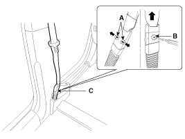
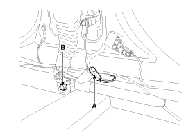

# Kia Sportage: Pretensores de Aceleração: Procedimentos de Reparo

[Home](../../index.md) / [Manual de Serviço e Reparo do Kia Sportage SL](../sportage-482.md) / [Restrição](sportage-848.md) / [Cinto de Segurança Pretensores](sportage-887.md) / Pretensores de Aceleração: Procedimentos de Reparo

## Remoção

1. Desconecte o cabo negativo da bateria, e aguarde pelo menos trinta segundos antes de começar o trabalho.

2. Para remover o pretensores de aceleração do cinto de segurança (C), mantenha as varetas de bloqueio (A) empurradas na direção indicada pelas setas. Em seguida, remova o cinto de segurança após empurrar a vareta de bloqueio (B).

   

3. Remova as seguintes peças. (Consulte o grupo Corpo-Interior)

   | – | Trim da porta |
   | --- | --- |

   | – | Trim do pilar central |
   | --- | --- |

4. Desconecte o conector do pretensores de aceleração (A).

   

5. Alinhe o parafuso de montagem do pretensores de aceleração (B) e remova a peça.

## Instalação

1. Remova a chave do motor do veículo.

2. Desconecte o cabo negativo (-) da bateria e aguarde pelo menos trinta segundos.

3. Instale o pretensores de aceleração com uma viga.

   ```
   Torque de aperto:
   39,2 ~ 53,9 N.m(4,0 ~ 5,5 kgf.m, 28,9 ~ 39,8 lb-ft)
   ```

4. Conecte o conector do pretensores de aceleração.

5. Instale as seguintes peças. (Consulte o grupo Corpo-Interior)

   | – | Trim do pilar central |
   | --- | --- |

   | – | Trim da porta |
   | --- | --- |

6. Insira o cinto de segurança no pretensores de aceleração.

   > **Nota**
   >
   > - Certifique-se de que a vareta de bloqueio esteja conectada corretamente.

7. Reconecte o cabo negativo da bateria.

8. Após a instalação do pretensores de aceleração, confirme a operação correta do sistema:

   | • | Ligue o interruptor do acendedor; a luz do indicador SRS deve acender por cerca de seis segundos e depois apagar. |
   | --- | --- |
