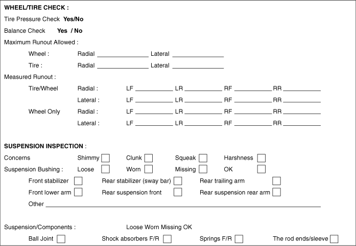

# Kia Sportage: Diagnóstico

[Início](../../index.md) / [Manual de Serviço e Reparo do Kia Sportage SL](../sportage-482.md) / [Sistema de Suspensão](sportage-813.md) / Diagnóstico

## Diagnóstico

Inspeção do veículo

CHART DE SINTOMAS

| Sintoma | Área Suspeita | Correção (Veja a página) |
| --- | --- | --- |
| Sussurro ou grunhido - som do sistema de suspensão dianteira, ocorre mais em temperaturas mais baixas - mais notável em estradas irregulares ou quando virando | Barra estabilizadora dianteira | Sob essas condições, o som é aceitável. |
| Clonk - som do sistema de suspensão dianteira, ocorre em e fora de curvas | Parafusos ou amortecedores dianteiros soltos | Inspeção para parafusos ou parafusos soltos. Ajuste conforme especificação. |
| Clonk - som do sistema de suspensão traseiro, ocorre ao engrenar de ré para marcha | Componentes do sistema de suspensão traseiro soltos ou danificados | Inspeção para componentes do sistema de suspensão traseiro soltos ou danificados. Repare ou instale novos componentes conforme necessário. |
| Clique ou estalo - som do sistema de suspensão dianteira, mais notável em estradas irregulares ou em buracos | Molas de articulação danificadas ou desgastadas | Instale nova peça inferior conforme necessário. |
| Clique ou estalo - som ocorre ao girar o veículo | Molas de articulação danificadas ou desgastadas | Instale nova peça inferior conforme necessário. |
| Clique ou estalido - ocorre ao acelerar em curvas | Juntas Birfield danificadas ou desgastadas | Repare ou instale nova junta Birfield conforme necessário. Ver grupo DS - transmissão. |
| Som do sistema de suspensão dianteira - sussurro, crepitar ou estalar - ocorre principalmente em buracos ou estradas irregulares | Componentes de direção Parafusos ou amortecedores dianteiros soltos ou torcidos Molas ou montantes de molas danificados ou desgastados Molas de articulação de braço danificadas ou desgastadas Molas de barra estabilizadora ou links danificadas ou desgastadas | Vá para o teste detalhado A. |
| Grufti ou arranhão - som do amortecedor dianteiro, ocorre ao dirigir em estradas irregulares ou ao girar o veículo | Superfície de montagem irregular entre a isolante e o painel pela sujeira ao redor dos parafusos de montagem da insulante do amortecedor e das fendas de montagem dos parafusos da insulante | Repare ou instale novas peças conforme necessário. |
| Som do sistema de suspensão traseiro - sussurro, crepitar ou estalar - ocorre principalmente em buracos ou estradas irregulares | Amortecedores traseiros soltos ou torcidos Molas ou montantes de molas danificados ou desgastados Molas de articulação de braço de controle danificadas ou desgastadas | Vá para o teste detalhado B. |
| Tremor - ocorre durante aceleração de baixa velocidade ou parada | Montagem do eixo traseiro mal posicionada Componentes do sistema de suspensão dianteiro danificados ou desgastados | Verifique as montagens do eixo traseiro e do sistema de suspensão traseiro para danos ou desgaste. Repare conforme necessário. Verifique a barra estabilizadora solta, amortecedores ou parafusos de amortecedor soltos ou desgastados ou parafusos de articulação de braço soltos ou desgastados. Inspeção do ligamento de direção para desgaste ou danos. Repare ou instale novas peças conforme necessário. |
| Tremor - mais notável em desaceleração - também condição de direção dura | Caster positivo excessivo | Verifique o ângulo de alinhamento do caster. Corrija conforme necessário. |
| Som do pneu - hum/moan a velocidades constantes | Padronagens de desgaste anormais | Vire o pneu e verifique o desgaste do pneu. Instale um novo pneu conforme necessário. Verifique componentes do sistema de suspensão danificados ou desgastados. Realize alinhamento dos pneus. |

| Som de pneu - o tom do som diminui à medida que a velocidade do veículo é reduzida | Pneu fora de equilíbrio | Balance o pneu e faça um teste de estrada. Instale um novo pneu se necessário. |
| Som de pneu - som de tic-tac que muda com a velocidade | Furada no pneu ou pedra no pneu | Inspeção do pneu. Repare ou substitua se necessário. |
| Roda e pneu - vibração e som de preocupação estão diretamente relacionados à velocidade do veículo e não são afetados pela aceleração, coasting ou desaceleração | Pneu danificado ou desgastado | Realize o teste detalhado C. |
| Tremor ou tremer do pneu - ocorre em velocidades mais baixas | Rodas de rotação danificadas | Girar o pneu e verificar se há movimento anormal nas rodas de rotação ou se estão ásperas. Ajuste ou instale novas rodas de rotação conforme necessário. Consulte o grupo DS - eixo dianteiro/traseiro. |
| Roda danificada | Inspeção da roda para danos. Instale uma nova roda se necessário. |
| Componentes de suspensão danificados ou desgastados | Inspeção dos componentes de suspensão para desgaste ou danos. Repare conforme necessário. |
| Rodas de rotação soltas | Verificação das rolas de rotação. Ajuste de acordo com a especificação. |
| Desgaste irregular do pneu | Girar o pneu e verificar se há desgaste irregular ou danos. Instale um novo pneu se necessário. |
| Tremor ou balanço do pneu - ocorre em velocidades mais baixas | Pneu ou roda fora de equilíbrio |
| Desgaste irregular do pneu | Verificação de desgaste irregular do pneu. Instale um novo pneu se necessário. |
| Excesso de runout radial da roda ou pneu | Realize um teste de runout radial da roda e do pneu. Instale um novo pneu se necessário. |
| Estôdios ou furos danificados ou alargados | Inspeção das estôdios e das rodas. Instale novos componentes conforme necessário. |
| Excesso de runout lateral da roda ou pneu | Realize um teste de runout lateral da roda e do pneu. Verifique a roda, o pneu e o eixo. Repare ou instale novos componentes conforme necessário. |
| Material estranho entre o disco de freio e o eixo de montagem. | Limpe as superfícies de montagem do disco de freio e do eixo de montagem. Consulte o grupo DS - eixo dianteiro/traseiro. |
| Tremor ou balanço em alta velocidade - ocorre em alta velocidade | Excesso de runout do eixo de rotação da roda Danos ou desgaste do pneu Danos ou desgaste das rodas de rotação Danos ou desgaste dos componentes de suspensão ou direção Estôdios ou discos de freio fora de equilíbrio | Realize o teste detalhado D. |
| Desvio para a esquerda ou para a direita | Pneus Direção Direção inferior da roda dianteira Articulação do eixo inferior da roda dianteira | Realize o teste detalhado E. |
| Direção do volante | Alinhamento Direção Articulação do eixo inferior da roda dianteira | Realize o teste detalhado F. |
| Rastro incorreto | Suspensão traseira Caster | Realize o teste detalhado G. |
| Viagem irregular | Assemblagem de molas e amortecedor dianteiro Assemblagem de molas e amortecedor traseiro | Realize o teste detalhado H. |
| Excesso de ruído | Componentes do estabilizador dianteiro ou traseiro Molas Suspensão Componentes do amortecedor | Realize o teste detalhado I. |
| Desgaste irregular do pneu | Pneu ou roda fora de equilíbrio Inflação do pneu Alinhamento do pneu Assemblagem do pneu Amortecedor do pneu | Realize o teste detalhado J. |

| Vibração | Roda/ pneu Rodas dianteiras do eixo de transmissão Direção do veículo Amortecedor e mola do eixo do amortecedor Mola e amortecedor de montagem do eixo do amortecedor Amortecedor e mola do eixo do eixo do eixo do amortecedor Amortecedor e mola do eixo do eixo do eixo do eixo do eixo do eixo do eixo do eixo do eixo do eixo do eixo do eixo do eixo do eixo do eixo do eixo do eixo do eixo do eixo do eixo do eixo do eixo do eixo do eixo do eixo do eixo do eixo do eixo do eixo do eixo do eixo do eixo do eixo do eixo do eixo do eixo do eixo do eixo do eixo do eixo do eixo do eixo do eixo do eixo do eixo do eixo do eixo do eixo do eixo do eixo do eixo do eixo do eixo do eixo do eixo do eixo do eixo do eixo do eixo do eixo do eixo do eixo do eixo do eixo do eixo do eixo do eixo do eixo do eixo do eixo do eixo do eixo do eixo do eixo do eixo do eixo do eixo do eixo do eixo do eixo do eixo do eixo do eixo do eixo do eixo do eixo do eixo do eixo do eixo do eixo do eixo do eixo do eixo do eixo do eixo do eixo do eixo do eixo do eixo do eixo do eixo do eixo do eixo do eixo do eixo do eixo do eixo do eixo do eixo do eixo do eixo do eixo do eixo do eixo do eixo do eixo do eixo do eixo do eixo do eixo do eixo do eixo do eixo do eixo do eixo do eixo do eixo do eixo do eixo do eixo do eixo do eixo do eixo do eixo do eixo do eixo do eixo do eixo do eixo do eixo do eixo do eixo do eixo do eixo do eixo do eixo do eixo do eixo do eixo do eixo do eixo do eixo do eixo do eixo do eixo do eixo do eixo do eixo do eixo do eixo do eixo do eixo do eixo do eixo do eixo do eixo do eixo do eixo do eixo do eixo do eixo do eixo do eixo do eixo do eixo do eixo do eixo do eixo do eixo do eixo do eixo do eixo do eixo do eixo do eixo do eixo do eixo do eixo do eixo do eixo do eixo do eixo do eixo do eixo do eixo do eixo do eixo do eixo do eixo do eixo do eixo do eixo do eixo do eixo do eixo do eixo do eixo do eixo do eixo do eixo do eixo do eixo do eixo do eixo do eixo do eixo do eixo do eixo do eixo do eixo do eixo do eixo do eixo do eixo do eixo do eixo do eixo do eixo do eixo do eixo do eixo do eixo do eixo do eixo do eixo do eixo do eixo do eixo do eixo do eixo do eixo do eixo do eixo do eixo do eixo do eixo do eixo do eixo do eixo do eixo do eixo do eixo do eixo do eixo do eixo do eixo do eixo do eixo do eixo do eixo do eixo do eixo do eixo do eixo do eixo do eixo do eixo do eixo do eixo do eixo do eixo do eixo do eixo do eixo do eixo do eixo do eixo do eixo do eixo do eixo do eixo do eixo do eixo do eixo do eixo do eixo do eixo do eixo do eixo do eixo do eixo do eixo do eixo do eixo do eixo do eixo do eixo do eixo do eixo do eixo do eixo do eixo do eixo do eixo do eixo do eixo do eixo do eixo do eixo do eixo do eixo do eixo do eixo do eixo do eixo do eixo do eixo do eixo do eixo do eixo do eixo do eixo do eixo do eixo do eixo do eixo do eixo do eixo do eixo do eixo do eixo do eixo do eixo do eixo do eixo do eixo do eixo do eixo do eixo do eixo do eixo do eixo do eixo do eixo do eixo do eixo do eixo do eixo do eixo do eixo do eixo do eixo do eixo do eixo do eixo do eixo do eixo do eixo do eixo do eixo do eixo do eixo do eixo do eixo do eixo do eixo do eixo do eixo do eixo do eixo do eixo do eixo do eixo do eixo do eixo do eixo do eixo do eixo do eixo do eixo do eixo do eixo do eixo do eixo do eixo do eixo do eixo do eixo do eixo do eixo do eixo do eixo do eixo do eixo do eixo do eixo do eixo do eixo do eixo do eixo do eixo do eixo do eixo do eixo do eixo do eixo do eixo do eixo do eixo do eixo do eixo do eixo do eixo do eixo do eixo do eixo do eixo do eixo do eixo do eixo do eixo do eixo do eixo do eixo do eixo do eixo do eixo do eixo do eixo do eixo do eixo do eixo do eixo do eixo do eixo do eixo do eixo do eixo do eixo do eixo do eixo do eixo do eixo do eixo do eixo do eixo do eixo do eixo do eixo do eixo do eixo do eixo do eixo do eixo do eixo do eixo do eixo do eixo do eixo do eixo do eixo do eixo do eixo do eixo do eixo do eixo do eixo do eixo do eixo do eixo do eixo do eixo do eixo do eixo do eixo do eixo do eixo do eixo do eixo do eixo do eixo do eixo do eixo do eixo do eixo do eixo do eixo do eixo do eixo do eixo do eixo do eixo do eixo do eixo do eixo do eixo do eixo do eixo do eixo do eixo do eixo do eixo do eixo do eixo do eixo do eixo do eixo do eixo do eixo do eixo do eixo do eixo do eixo do eixo do eixo do eixo do eixo do eixo do eixo do eixo do eixo do eixo do eixo do eixo do eixo do eixo do eixo do eixo do eixo do eixo do eixo do eixo do eixo do eixo do eixo do eixo do eixo do eixo do eixo do eixo do eixo do eixo do eixo do eixo do eixo do eixo do eixo do eixo do eixo do eixo do eixo do eixo do eixo do eixo do eixo do eixo do eixo do eixo do eixo do eixo do eixo do eixo do eixo do eixo do eixo do eixo do eixo do eixo do eixo do eixo do eixo do eixo do eixo do eixo do eixo do eixo do eixo do eixo do eixo do eixo do eixo do eixo do eixo do eixo do eixo do eixo do eixo do eixo do eixo do eixo do eixo do eixo do eixo do eixo do eixo do eixo do eixo do eixo do eixo do eixo do eixo do eixo do eixo do eixo do eixo do eixo do eixo do eixo do eixo do eixo do eixo do eixo do eixo do eixo do eixo do eixo do eixo do eixo do eixo do eixo do eixo do eixo do eixo do eixo do eixo do eixo do eixo do eixo do eixo do eixo do eixo do eixo do eixo do eixo do eixo do eixo do eixo do eixo do eixo do eixo do eixo do eixo do eixo do eixo do eixo do eixo do eixo do eixo do eixo do eixo do eixo do eixo do eixo do eixo do eixo do eixo do eixo do e

Translate this Markdown chunk (5/13) para o português do Brasil.

|  | Verifique as molas dianteiras e os montantes ou suportes das molas dianteiras para desgaste ou danos ? As molas dianteiras ou os montantes ou suportes das molas dianteiras estão desgastados ou danificados ? > SIM Repare ou instale novos componentes conforme necessário. Teste o sistema para operação normal. > NÃO Vá para A5. |
| A5. VERIFIQUE O BARRAMENTO |  |
|  | 1) Verifique as dobradiças e os links do barramento para danos ou desgaste. 2) Verifique o barramento para danos. 3) Verifique se os suportes do barramento estão soltos ou danificados. ? Os componentes do barramento/track bar estão soltos, desgastados ou danificados ? > SIM Repare ou instale novos componentes conforme necessário. Teste o sistema para operação normal. > NÃO O sistema de suspensão está OK. Realize a diagnóstico em outros sistemas suspeitos. |
| 1) | Verifique as dobradiças e os links do barramento para danos ou desgaste. |
| 2) | Verifique o barramento para danos. |
| 3) | Verifique se os suportes do barramento estão soltos ou danificados. ? Os componentes do barramento/track bar estão soltos, desgastados ou danificados ? > SIM Repare ou instale novos componentes conforme necessário. Teste o sistema para operação normal. > NÃO O sistema de suspensão está OK. Realize a diagnóstico em outros sistemas suspeitos. |

DEDETALHADO TESTE B : RUÍDO DE SISTEMA DE SUSTENTAÇÃO TRASEIRA

| CONDIÇÕES | DETALHES/RESULTADOS/AÇÕES |
| --- | --- |
| B1. TESTE DE VIAGEM NA VIA |  |
|  | 1) Teste de viagem do veículo. 2) Durante o teste de viagem, conduza o veículo em uma via irregular. Determine a origem do ruído. ? Há um ruído de chiado, cricri ou ronco ? > SIM Vá para B2. > NÃO O sistema de suspensão está OK. Realize a diagnóstico em outros sistemas suspeitos. |
| 1) | Teste de viagem do veículo. |
| 2) | Durante o teste de viagem, conduza o veículo em uma via irregular. Determine a origem do ruído. ? Há um ruído de chiado, cricri ou ronco ? > SIM Vá para B2. > NÃO O sistema de suspensão está OK. Realize a diagnóstico em outros sistemas suspeitos. |
| B2. CHEQUE OS AMORTECENTES TRASEIROS/PISTÔES |  |
|  | 1) Elevação e suporte do veículo. Ver GI grupo - pontos de elevação. 2) Verifique os suportes dos amortecentes traseiros/pistões para parafusos ou parafusos soltos. 3) Verifique os amortecentes traseiros/pistões para danos. Realize o teste do amortecedor. ? Os amortecentes traseiros/pistões estão soltos ou danificados ? > SIM Ajuste conforme especificação se soltos. Instale novos amortecentes traseiros/pistões se danificados. Teste o sistema para operação normal. > NÃO Vá para B3. |
| 1) | Elevação e suporte do veículo. Ver GI grupo - pontos de elevação. |
| 2) | Verifique os suportes dos amortecentes traseiros/pistões para parafusos ou parafusos soltos. |
| 3) | Verifique os amortecentes traseiros/pistões para danos. Realize o teste do amortecedor. ? Os amortecentes traseiros/pistões estão soltos ou danificados ? > SIM Ajuste conforme especificação se soltos. Instale novos amortecentes traseiros/pistões se danificados. Teste o sistema para operação normal. > NÃO Vá para B3. |
| B3. CHEQUE AS MOLAS TRASEIRAS |  |

|  | Verifique as molas traseiras e as montagens ou suportes das molas traseiras para danos ou desgaste. ? As molas traseiras ou as montagens ou suportes das molas traseiras estão danificadas ou desgastadas ? > SIM Repare ou instale novos componentes conforme necessário. Teste o sistema para operação normal. > NÃO Vá para B4. |
| B4. VERIFIQUE OS BANCOS TRASEIROS |  |
|  | 1) Inspeção das articulações dos bancos traseiros para desgaste ou danos. Verifique se há parafusos de banco traseiro soltos. 2) Inspeção para bancos traseiros torcidos ou deformados. ? Os bancos traseiros estão soltos, danificados ou desgastados ? > SIM Repare ou instale novos componentes conforme necessário. Teste o sistema para operação normal. > NÃO Sistema de suspensão está OK. Realize diagnóstico em outros sistemas suspeitos. |
| 1) | Inspeção das articulações dos bancos traseiros para desgaste ou danos. Verifique se há parafusos de banco traseiro soltos. |
| 2) | Inspeção para bancos traseiros torcidos ou deformados. ? Os bancos traseiros estão soltos, danificados ou desgastados ? > SIM Repare ou instale novos componentes conforme necessário. Teste o sistema para operação normal. > NÃO Sistema de suspensão está OK. Realize diagnóstico em outros sistemas suspeitos. |

TESTE DETALHADO C : PNEUS E RODAS

| CONDIÇÕES | DETALHES/RESULTADOS/AÇÕES |
| --- | --- |
| C1. TESTE DE VIAGEM DO VEÍCULO |  |
|  | Vibrações ou ruídos sentidos no volante são provavelmente relacionados com os pneus ou rodas da frente. Vibrações sentidas através do assento são provavelmente relacionadas com os pneus ou rodas da traseira. Isso não é sempre verdadeiro, mas pode ajudar a isolar o problema na frente ou traseira do veículo. Teste o veículo em diferentes faixas de velocidade. Durante o teste de viagem, se a vibração pode ser eliminada colocando o veículo em neutral ou se é afetada pela velocidade do motor, a causa não são os pneus ou rodas. ? Há vibração e ruído ? > SIM Vá para C2. > NÃO Pneus e rodas estão OK. Realize diagnóstico em outros sistemas suspeitos. |
| Vibrações ou ruídos sentidos no volante são provavelmente relacionados com os pneus ou rodas da frente. Vibrações sentidas através do assento são provavelmente relacionadas com os pneus ou rodas da traseira. Isso não é sempre verdadeiro, mas pode ajudar a isolar o problema na frente ou traseira do veículo. Teste o veículo em diferentes faixas de velocidade. |  |
| C2. VERIFIQUE OS RODOPES DA RODA DA FRONTE |  |
|  | Verifique os rodopos da roda da frente. Consulte Verificação do Rodope da Roda (Veja o grupo DS - eixo dianteiro). ? Os rodopos da roda estão OK ? > SIM Vá para C3. > NÃO Inspeção dos rodopos da roda. Ajuste ou Repare conforme necessário. Teste o sistema para operação normal. |
| C3. INSPEÇÃO DOS PNEUS |  |
|  | 1) Verifique os pneus para pesos faltantes. 2) Verifique as rodas para danos. 3) Inspeção do padrão de desgaste do pneu. ? Os pneus têm um padrão de desgaste anormal ? > SIM Corrija a condição que causou o desgaste anormal. Instale novo pneu(s). Teste o sistema para operação normal. > NÃO Vá para C4. |
| 1) | Verifique os pneus para pesos faltantes. |
| 2) | Verifique as rodas para danos. |

| 3) | Inspecione o padrão de desgaste da pneumatização. ? Os pneus apresentam algum padrão de desgaste anormal ? > SIM Corrija a condição que causou o desgaste anormal. Instale novos pneu(s). Teste o sistema para operação normal. > NÃO Vá para C4. |
| C4. DIAGNÓSTICO DE ROTACAO DE PNEUMATIZAÇÃO |  |
|  | 1) Faça rolar os pneus lentamente e observe sinais de rotação lateral. 2) Faça rolar os pneus lentamente e observe sinais de rotação radial. ? Há sinais de rotação visível ? > SIM Vá para C5. > NÃO Verifique o equilíbrio do pneu e do pneu. Corrija se necessário. Teste o sistema para operação normal. |
| 1) | Faça rolar os pneus lentamente e observe sinais de rotação lateral. |
| 2) | Faça rolar os pneus lentamente e observe sinais de rotação radial. ? Há sinais de rotação visível ? > SIM Vá para C5. > NÃO Verifique o equilíbrio do pneu e do pneu. Corrija se necessário. Teste o sistema para operação normal. |
| C5. VERIFICAÇÃO DE ROTAÇÃO RADIAL DO PNEUMATIZAÇÃO |  |
|  | Medir
 a rotação radial do pneu e do pneu. Uma especificação típica para rotação radial total é 1,15mm (0,059 polegada). ? A rotação radial está dentro das especificações ? > SIM Vá para C8. > NÃO Vá para C6. |
| C6. VERIFICAÇÃO DE ROTAÇÃO RADIAL DA ROda |  |
|  | Medir a rotação radial da roda. Uma especificação típica para rotação radial total é 1,14mm (0,045 polegada.). ? A rotação radial está dentro das especificações ? > SIM Instale um novo pneu. Teste o sistema para operação normal. > NÃO Vá para C7. |
| C7. VERIFICAÇÃO DO DESLOCAMENTO RADIAL DA HUB/DISCO DE FREIO OU DO DISCO DE FREIO PILOTO OU DO CÍRCULO DE GARRAS |  |
|  | Medir o deslocamento radial do piloto ou do círculo de garras. Uma especificação típica para deslocamento radial é : ? deslocamento radial do piloto - menos de 0,15mm (0,006 polegada) ? deslocamento radial do círculo de garras - menos de 0,38mm (0,015 polegada) ? O deslocamento radial está dentro das especificações ? > SIM Instale uma nova roda. Teste o sistema para operação normal. > NÃO Repare ou instale novos componentes conforme necessário. |
| C8. VERIFICAÇÃO DE ROTAÇÃO LATERAL DO PNEUMATIZAÇÃO |  |
|  | Medir
 a rotação lateral do pneu e do pneu. Uma especificação típica para rotação lateral total é 2,5mm (0,098 polegada). ? A rotação lateral está dentro das especificações ? > SIM Pneu e pneus estão OK. Realize o diagnóstico de outros sistemas suspeitos. > NÃO Vá para C9. |
| C9. VERIFICAÇÃO DE ROTAÇÃO LATERAL DA ROda |  |
|  | Medir a rotação lateral da roda. Uma especificação típica para rotação radial total é 1,2mm (0,047 polegada.) ? A rotação lateral está dentro das especificações ? > SIM Instale um novo pneu. Teste o sistema para operação normal. > NÃO Vá para C10. |
| C10. VERIFICAÇÃO DO DESLOCAMENTO LATERAL DA FACE DA FLANGE |  |
|  | Medir o deslocamento lateral da face da flange. Uma especificação típica para deslocamento lateral é : ? hub/disco de freio - menos de 0,13mm (0,005 polegada) ? O deslocamento lateral está dentro das especificações ? > SIM Instale uma nova roda. Teste o sistema para operação normal. > NÃO Repare ou instale novos componentes conforme necessário. |

TESTE DETALHADO D :

| CONDIÇÕES | DETALHES/RESULTADOS/AÇÕES |
| --- | --- |
| D1. VERIFICAÇÃO DE RUGOSIDADE DO ROLAMENTO DA RODA FRONTAL |  |

|  | 1) Elevar e sustentar o final da viatura para que os pneus e montagens de pneus do frente possam girar. Ver grupo GI - ponto de elevação e sustentação. 2) Gire os pneus do frente à mão. ? Os rolamentos dos pneus parecem ásperos? > SIM Inspecione os rolamentos dos pneus. Repare conforme necessário. Teste o sistema para operação normal. > NÃO Vá para D2. |
| 1) | Elevar e sustentar o final da viatura para que os pneus e montagens de pneus do frente possam girar. Ver grupo GI - ponto de elevação e sustentação. |
| 2) | Gire os pneus do frente à mão. ? Os rolamentos dos pneus parecem ásperos? > SIM Inspecione os rolamentos dos pneus. Repare conforme necessário. Teste o sistema para operação normal. > NÃO Vá para D2. |
| D2. VERIFIQUE O DESLOCAMENTO DE FIM DOS ROLAMENTOS DOS PNEUS DO FRETE |  |
|  | Verifique o deslocamento de fim dos rolamentos dos pneus do frente. ? O deslocamento de fim está dentro das especificações? > SIM Vá para D3. > NÃO Ajuste ou Repare conforme necessário. Teste o sistema para operação normal. |
| D3. MEDIR O DESLOCAMENTO LATERAL E O DESLOCAMENTO RADIAL DOS PNEUS DO FRETE NA VIATURA |  |
|  | Medir o deslocamento lateral e o deslocamento radial dos pneus do frente na viatura. Vá para o teste detalhado C. ? As medições estão dentro das especificações? > SIM Vá para D4. > NÃO Instale novos pneus conforme necessário e Balanceie a montagem. Teste o sistema para operação normal. |
| D4. MEDIR O DESLOCAMENTO LATERAL DOS PNEUS DO FRETE NA VIATURA |  |
|  | Medir o deslocamento lateral dos pneus do frente na viatura. Vá para o teste detalhado C. ? O deslocamento está dentro das especificações? > SIM Balanceie
 a montagem dos pneus e roda. Se qualquer pneu não puder ser balanceado,
instale um novo pneu. Teste o sistema para operação normal. > NÃO Vá para D5. |
| D5. MEDIR O DESLOCAMENTO RADIAL DOS PNEUS DO FRETE NA VIATURA |  |
|  | Medir o deslocamento radial dos pneus do frente na viatura. Vá para o teste detalhado C. ? O deslocamento está dentro das especificações? > SIM Balanceie
 a montagem dos pneus e roda. Se qualquer pneu não puder ser balanceado,
instale um novo pneu. Teste o sistema para operação normal. > NÃO Vá para D6. |
| D6. MONTAR A RODA E A MONTAGEM DO PNEU EM COMBINAÇÃO |  |
|  | Marque
 a localização do ponto de deslocamento de fim alto no pneu e também na roda. Desmonte a montagem e rote a roda 180 graus (meio giro) na roda. Infla o pneu e mede o deslocamento radial. ? O deslocamento está dentro das especificações? > SIM Balanceie a montagem. Teste o sistema para operação normal. > NÃO Se o ponto alto não estiver a menos de 101,6mm (4 polegadas) do primeiro ponto alto no pneu, Vá para D7. |
| D7. MEDIR O DESLOCAMENTO DE FIM DA FLANGE DA RODA |  |
|  | Desmonte o pneu e monte a roda em um balançador de rodas. Mede o deslocamento em ambas as flanges da roda. Vá para o teste detalhado C ? O deslocamento está dentro das especificações? > SIM Localize
 e marque o ponto baixo na roda. Instale o pneu, alinhando o ponto alto do pneu com o ponto baixo na roda. Balanceie a montagem.
Teste o sistema para operação normal. Se a condição persistir, Vá para D8. > NÃO Instale
 uma nova roda. Verifique o deslocamento da nova roda. Se a nova roda estiver dentro dos limites, localize e marque o ponto baixo. Instale o pneu, alinhando

o ponto alto da rodagem com o ponto baixo da roda. Balanceie a
montagem. Teste o sistema para operação normal. Se a condição
persistir, vá para D8. |
| D8. VERIFIQUE A VIBRAÇÃO DO FRENTE DO VEÍCULO |  |
|  | Balanceie as montagens da roda e da rodagem da frente com um balançador de rodas enquanto o
veículo estiver elevado em um elevador. Sinta a vibração no para-choque dianteiro ou
enquanto estiver sentado no veículo. ? A vibração está presente? > SIM Substitua as rodas e as rodagens conhecidas e boas conforme necessário. Teste o sistema para operação normal. > NÃO Verifique os componentes do tração. Teste o sistema para operação normal. |

TESTE DETALHADO E : DESVIO À ESQUERDA OU À DIREITA

| CONDIÇÕES | DETALHES/RESULTADOS/AÇÕES |
| --- | --- |
| E1. VERIFIQUE AS RODAS |  |
|  | Inspeção as rodas para desgaste excessivo ou danos. ? As rodas estão desgastadas excessivamente ou danificadas? > SIM Instale novas rodas. > NÃO Vá para E2. |
| E2. VERIFIQUE A TRANSMISSÃO DE DIREÇÃO |  |
|  | 1) Elevar e sustentar o veículo. 2) Verifique os componentes de direção para indicações de desgaste excessivo ou danos. Verifique o grupo ST - especificação. ? Há indicação de desgaste excessivo ou danos? > SIM Repare ou instale novos componentes conforme necessário. > NÃO Vá para E3. |
| 1) | Elevar e sustentar o veículo. |
| 2) | Verifique os componentes de direção para indicações de desgaste excessivo ou danos. Verifique o grupo ST - especificação. ? Há indicação de desgaste excessivo ou danos? > SIM Repare ou instale novos componentes conforme necessário. > NÃO Vá para E3. |
| E3. VERIFIQUE A ALINHAMENTO DO VEÍCULO |  |
|  | 1) Coloque o veículo em um rack de alinhamento. Verifique o alinhamento do veículo. ? O alinhamento está dentro da especificação? > SIM Vá para E4. > NÃO Ajuste o alinhamento conforme necessário. |
| 1) | Coloque o veículo em um rack de alinhamento. Verifique o alinhamento do veículo. ? O alinhamento está dentro da especificação? > SIM Vá para E4. > NÃO Ajuste o alinhamento conforme necessário. |
| E4. DIAGNÓSTICO DE TRAGA DOS FREIOS |  |
|  | Aplique os freios ao dirigir. ? O veículo desvia ou puxa quando os freios são aplicados? > SIM Verifique o grupo BR - especificação. > NÃO Se o volante estiver no centro, o veículo está OK. Se o volante estiver deslocado, vá para o Teste Detalhado F. |

TESTE DETALHADO F : VOLANTE DESLOCADO

| CONDIÇÕES | DETALHES/RESULTADOS/AÇÕES |
| --- | --- |
| F1. VERIFIQUE A VISÃO CLARA |  |
|  | Coloque o veículo em um rack de alinhamento. ? A visão clara está dentro da especificação? > SIM Vá para F2. > NÃO Ajuste a visão clara conforme a especificação. |
| F2. INSPEÇÃO DOS COMPONENTES DE DIREÇÃO |  |
|  | 1) Elevar e sustentar o veículo. 2) Inspeção dos componentes de direção para desgaste excessivo ou danos. Verifique o grupo ST - especificação. ? Os componentes de direção estão desgastados excessivamente ou danificados? > SIM Repare ou instale novos componentes conforme necessário. > NÃO Se o veículo segue corretamente, o veículo está OK. Se o veículo segue incorretamente, vá para o Teste Detalhado |
| 1) | Elevar e sustentar o veículo. |

Translate this Markdown chunk (10/13) para o português do Brasil.

| 2) | Inspeção dos componentes de direção para desgaste excessivo ou danos. Verifique o grupo ST - especificação. ? Os componentes de direção estão desgastados ou danificados excessivamente ? > SIM Reparar ou instalar novos componentes conforme necessário. > NÃO Se a direção estiver correta, o veículo está OK. Se a direção estiver incorreta, vá para o Teste Detalhado. |

TESTE DETALHADO G : DIREÇÃO INCORRETA

| CONDIÇÕES | DETALHES/RESULTADOS/AÇÕES |
| --- | --- |
| G1. VERIFIQUE O CASTER |  |
|  | Posicione o veículo em um rack de alinhamento. ? O caster está dentro da especificação ? > SIM Vá para G2. > NÃO Substitua partes torcidas ou danificadas. |
| G2. VERIFIQUE A SUSPENSÃO TRASEIRA |  |
|  | 1) Medir a base do veículo para o lado direito (LH) e para o lado esquerdo (RH). 2) Comparar as medições. ? As medições são iguais ? > SIM Se a viagem for suave, o veículo está OK. Se a viagem for áspera, vá para o Teste Detalhado > NÃO Inspeção dos componentes da suspensão traseira para desgaste ou danos. Reparar ou instalar novos componentes conforme necessário. |
| 1) | Medir a base do veículo para o lado direito (LH) e para o lado esquerdo (RH). |
| 2) | Comparar as medições. ? As medições são iguais ? > SIM Se a viagem for suave, o veículo está OK. Se a viagem for áspera, vá para o Teste Detalhado > NÃO Inspeção dos componentes da suspensão traseira para desgaste ou danos. Reparar ou instalar novos componentes conforme necessário. |

TESTE DETALHADO H : VIAGEM ÁSPERA

| CONDIÇÕES | DETALHES/RESULTADOS/AÇÕES |
| --- | --- |
| H1. VERIFIQUE O AMORTecedor DA FRETEIRA |  |
|  | 1) Elevar e sustentar o veículo. 2) Inspeção do amortecedor da frente para vazamentos de óleo ou danos. ? As rodas estão desgastadas ou danificadas excessivamente ? > SIM Instalar novos amortecedores da frente. > NÃO Vá para H2. |
| 1) | Elevar e sustentar o veículo. |
| 2) | Inspeção do amortecedor da frente para vazamentos de óleo ou danos. ? As rodas estão desgastadas ou danificadas excessivamente ? > SIM Instalar novos amortecedores da frente. > NÃO Vá para H2. |
| H2. VERIFIQUE OS AMORTECIMENTOS DA TRASSEIRA |  |
|  | Inspeção dos amortecedores da traseira para vazamentos de óleo ou danos. ? Os amortecedores da traseira estão vazando ? > SIM Instalar novos amortecedores da traseira. > NÃO O veículo está OK. Vá para TROUBLESHOOTING. |

TESTE DETALHADO I : SOM EXCESSIVO

| CONDIÇÕES | DETALHES/RESULTADOS/AÇÕES |
| --- | --- |
| I1. INSPEÇÃO DA SUSPENSÃO |  |
|  | 1) Elevar e sustentar o veículo. 2) Inspeção das varetas de montagem do amortecedor. ? As varetas de montagem do amortecedor estão soltas ou quebradas ? > SIM Ajustar ou instalar novas varetas de montagem do amortecedor. > NÃO Vá para I2. |
| 1) | Elevar e sustentar o veículo. |
| 2) | Inspeção das varetas de montagem do amortecedor. ? As varetas de montagem do amortecedor estão soltas ou quebradas ? > SIM Ajustar ou instalar novas varetas de montagem do amortecedor. > NÃO Vá para I2. |
| I2. INSPEÇÃO DOS PONTOS DE APOIO E DAS BARRAS DE ESTABILIZAÇÃO |  |
|  | Inspeção das molas e barras de estabilização para danos. ? As molas ou barras de estabilização estão danificadas ? > SIM Instalar novas molas e/ou barras de estabilização. > NÃO Vá para I3. |
| I3. INSPEÇÃO DA SUSPENSÃO DA FRETEIRA |

Translate this Markdown chunk (11/13) para o português brasileiro.

|  | Inspeção dos componentes de suspensão dianteira para desgaste excessivo ou danos. ? Os componentes de suspensão dianteira estão desgastados ou danificados ? > SIM Instale novos componentes de suspensão dianteira. > NÃO O veículo está OK. Vá para TROUBLESHOOTING. |

DETAILED TEST J : DESGASTE INEQUÍVOCO DOS PNEUS

| CONDIÇÕES | DETALHES/RESULTADOS/AÇÕES |
| --- | --- |
| J1. INSPEÇÃO DOS PNEUS |  |
|  | 1) Elevar e sustentar o veículo. 2) Inspeção dos pneus para desgaste irregular na face interna ou externa. ? Existe desgaste irregular nos pneus ? > SIM Alinhamento do veículo. Instale novos pneus se muito desgastados. > NÃO Vá para J2. |
| 1) | Elevar e sustentar o veículo. |
| 2) | Inspeção dos pneus para desgaste irregular na face interna ou externa. ? Existe desgaste irregular nos pneus ? > SIM Alinhamento do veículo. Instale novos pneus se muito desgastados. > NÃO Vá para J2. |
| J2. DESGASTE IRREGULAR DOS PNEUS |  |
|  | Inspeção dos pneus para padrão de penachamento. ? Os pneus apresentam padrão de penachamento ? > SIM Alinhamento do veículo. Instale novos pneus se muito desgastados. > NÃO Vá para J3. |
| J3. VERIFICAÇÃO DE PNEUS DENTADOS |  |
|  | Inspeção dos pneus para desgaste em forma de tigela ou dishing. ? Os pneus estão desgastados em forma de tigela ou dishing ? > SIM Balanceamento e rotação dos pneus. > NÃO O veículo está OK. Vá para TROUBLESHOOTING. |

DETAILED TEST K : VIBRAÇÃO

| CONDIÇÕES | DETALHES/RESULTADOS/AÇÕES |
| --- | --- |
| K1. TESTE DE VIAGEM |  |
|  | Acelere o veículo até a velocidade em que o cliente indicou que ocorreu a vibração. ? A vibração está presente ? > SIM Vá para K2. > NÃO O veículo está OK. Vá para TROUBLESHOOTING. |
| K2. INSPEÇÃO DOS PNEUS |  |
|  | 1) Elevar e sustentar o veículo com um elevador de quadro de contato. 2) Inspeção dos pneus para desgaste extremo ou danos, desgaste em forma de tigela ou pontos planos. ? Os pneus estão OK ? > SIM Vá para K3. > NÃO Verifique os componentes de suspensão para alinhamento inadequado, desgaste anormal ou danos que possam ter contribuído para o desgaste dos pneus. Corrija as preocupações de suspensão e instale novos pneus. |
| 1) | Elevar e sustentar o veículo com um elevador de quadro de contato. |
| 2) | Inspeção dos pneus para desgaste extremo ou danos, desgaste em forma de tigela ou pontos planos. ? Os pneus estão OK ? > SIM Vá para K3. > NÃO Verifique os componentes de suspensão para alinhamento inadequado, desgaste anormal ou danos que possam ter contribuído para o desgaste dos pneus. Corrija as preocupações de suspensão e instale novos pneus. |
| K3. INSPEÇÃO DOS EMBREAGENS DO EIXO |  |
|  | Gire os pneus à mão para verificar a rouidez das embreagens do eixo dianteiro. ? A embreagem do eixo dianteiro está OK ? > SIM Vá para K4. > NÃO Instale novas embreagens do eixo dianteiro conforme necessário. Verifique o grupo Ds - eixo dianteiro. |
| K4. BALANCEAMENTO DOS PNEUS/EIXO |  |
|  | Verifique o balanceamento dos pneus e eixo. ? Os pneus estão balanceados ? > SIM Vá para K5. > NÃO Balanceie os pneus e eixo conforme necessário. |
| K5. MEDIDA DOS DESLOCAMENTOS |  |
|  | Para cada posição do eixo, medir, localizar e marcar os seguintes itens. - Ponto mais alto da montagem do pneu/eixo total de deslocamento radial - Ponto mais alto do deslocamento radial do eixo - Ponto mais alto do deslocamento lateral do eixo ? Os deslocamentos estão conforme especificado ? > SIM Vá para Pneus/Eixos. > NÃO Vá para K6. |
| K6. SUBSTITUIÇÃO DOS EIXOS E DOS PNEUS |

|  | 1) Substitua um conjunto de rodas e pneus conhecidos como bons. 2) Realize um teste de estrada. 3) Se o veículo ainda apresentar um balanço ou vibração, anote a velocidade do veículo e/ou a rotação do motor em que ocorre. ? A vibração é sentida? > SIM Desbalanceamento do motor/transmissão. Consulte a especificação dos grupos TR, EM, FL e EC. > NÃO Instale as montagens de pneus/rodas originais uma a uma, realizando um teste de estrada em cada etapa até identificar as rodas/direções danificadas. Teste o sistema para operação normal. |
| 1) | Substitua um conjunto de rodas e pneus conhecidos como bons. |
| 2) | Realize um teste de estrada. |
| 3) | Se o veículo ainda apresentar um balanço ou vibração, anote a velocidade do veículo e/ou a rotação do motor em que ocorre. ? A vibração é sentida? > SIM Desbalanceamento do motor/transmissão. Consulte a especificação dos grupos TR, EM, FL e EC. > NÃO Instale as montagens de pneus/rodas originais uma a uma, realizando um teste de estrada em cada etapa até identificar as rodas/direções danificadas. Teste o sistema para operação normal. |

Os sons, vibrações e dureza dos pneus e rodas estão diretamente relacionados à velocidade do veículo e não são geralmente afetados pela aceleração, desaceleração ou coasting. Além disso, rodas e pneus desbalanceados podem vibrar a mais de uma velocidade. Uma vibração afetada pela rotação do motor ou eliminada ao colocar a transmissão em Neutral não está relacionada aos pneus e rodas. De modo geral, vibrações sentidas no volante estão relacionadas às rodas e pneus da dianteira. Vibrações sentidas no assento ou no chão estão relacionadas às rodas e pneus da traseira. Isso pode isolar inicialmente um problema à dianteira ou traseira.

Deve-se prestar atenção cuidadosa às rodas e pneus. Existem vários sintomas que podem ser causados por rodas e pneus danificados ou desgastados. Realize uma inspeção visual cuidadosa das rodas e montagens de pneus. Vire lentamente os pneus e observe sinais de rotação lateral ou radial. Consulte a tabela de desgaste dos pneus para determinar as condições de desgaste e as ações necessárias.

| DIAGNÓSTICO DE RODAS E PNEUS |  |  |
| --- | --- | --- |
| Desgaste rápido no centro | Desgaste rápido nas laterais | Desgaste em uma lateral |
| • Desgaste no centro do pneu devido a pneus sobredimensionados • Falta de rotação • Excesso de toe nas rodas de tração • Aceleração pesada nas rodas de tração | • Pneus sobredimensionados • Componentes do sistema de suspensão desgastados • Velocidades de curva excessivas • Falta de rotação | • Ajuste de toe fora da especificação • Camber fora da especificação • Estruturas danificadas • Braço inferior danificado |
| • | Desgaste no centro do pneu devido a pneus sobredimensionados |  |
| • | Falta de rotação |  |
| • | Excesso de toe nas rodas de tração |  |
| • | Aceleração pesada nas rodas de tração |  |
| • | Pneus sobredimensionados |  |
| • | Componentes do sistema de suspensão desgastados |  |
| • | Velocidades de curva excessivas |  |
| • | Falta de rotação |  |
| • | Ajuste de toe fora da especificação |  |
| • | Camber fora da especificação |  |
| • | Estruturas danificadas |  |
| • | Braço inferior danificado |  |

| Desgaste parcial | Borboleta | Padrão de desgaste |
| • Causado por irregularidades pontiagudas nos tamboriais de freio | • Ajuste do alinhamento do pneu fora da especificação • Parafusos de travão danificados ou usados • Concha danificada | • Excesso de alinhamento do pneu nas rodas não-traction • Falta de rotação |
| • | Causado por irregularidades pontiagudas nos tamboriais de freio |  |
| • | Ajuste do alinhamento do pneu fora da especificação |  |
| • | Parafusos de travão danificados ou usados |  |
| • | Concha danificada |  |
| • | Excesso de alinhamento do pneu nas rodas não-traction |  |
| • | Falta de rotação |  |
