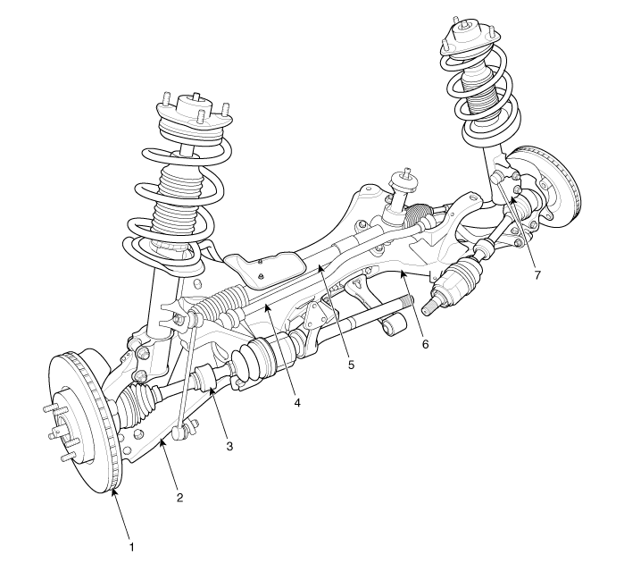

# Kia Sportage: Componentes e Localização dos Componentes

[Home](../../index.md) / [Manual de Serviço e Reparo do Kia Sportage SL](../sportage-482.md) / [Sistema de Suspensão](sportage-813.md) / [Sistema de Suspensão da Dianteira](sportage-817.md) / Componentes e Localização dos Componentes

## Localização dos Componentes

| 1. Eixo dianteiro 2. Braço de suspensão dianteiro inferior 3. Eixo driveshaft 4. Barra estabilizadora | 5. Caixa de direção 6. Subquadro 7. Conjunto de mola telescópica dianteira |
| --- | --- |
