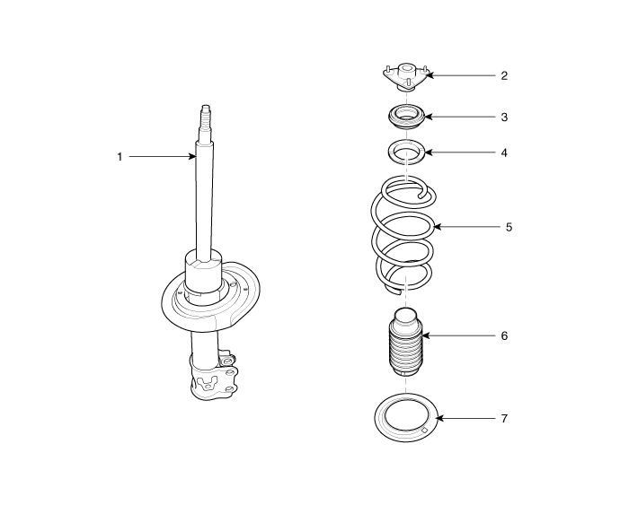

# Kia Sportage: Montagem do Estabilizador da Dianteira: Componentes e Localização dos Componentes

[Home](../../index.md) / [Manual de Serviço e Reparo do Kia Sportage SL](../sportage-482.md) / [Sistema de Suspensão](sportage-813.md) / [Sistema de Suspensão Dianteira](sportage-817.md) / Montagem do Estabilizador da Dianteira: Componentes e Localização dos Componentes

## Componentes

| 1. Montagem do estabilizador 2. Isolador 3. Rolamento 4. Pano superior da mola | 5. Mola 6. Cobertura antissujeira 7. Pano inferior da mola |
| --- | --- |
